# 全量对比图

> 历史快照：本报告对应 run `20261009-options-alignment`（目录已清理）。
> 当前发布口径以 [RELEASE_STATUS.md](RELEASE_STATUS.md) 与 [gallery/index.html](gallery/index.html) 为准。

运行：`20261009-options-alignment`。42 张详细图、150 张原图配置网格。 另含本轮 10 张修复与重测图；新 CUDA 和原完整基线分别标注。

[浏览器打开全部图](ALL_COMPARISONS.html) · [交互切换 1500 个图像配置](gallery/index.html)

## 全部模型与后端端到端延迟

[PNG](gallery/latency_all_backends.png) · [SVG](gallery/latency_all_backends.svg)

## CUDA / Vulkan 延迟放大图

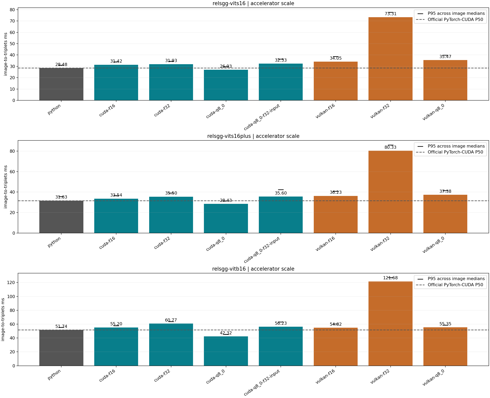

[PNG](gallery/latency_gpu_backends.png) · [SVG](gallery/latency_gpu_backends.svg)

## 各模型各后端速度倍率

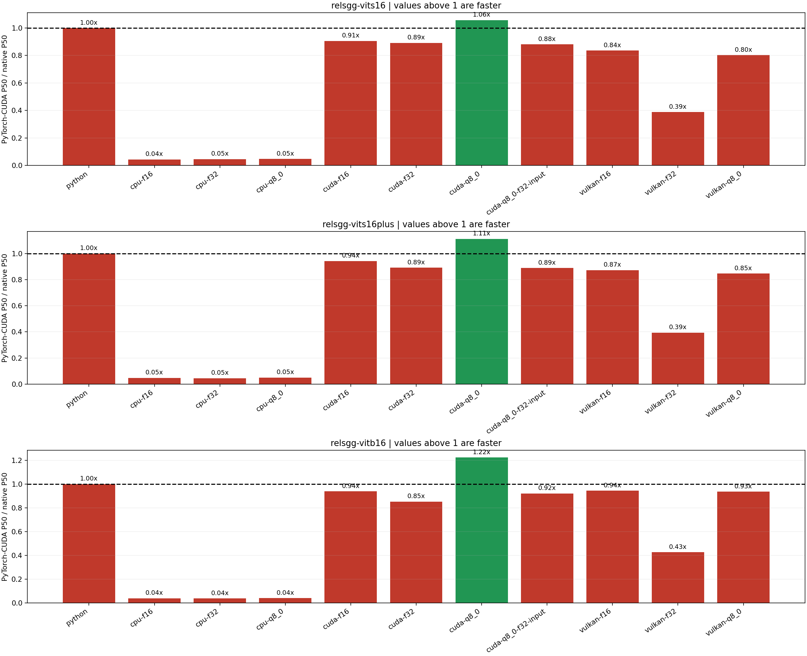

[PNG](gallery/speedup_all_backends.png) · [SVG](gallery/speedup_all_backends.svg)

## 精度和候选对一致率

[PNG](gallery/accuracy_candidates.png) · [SVG](gallery/accuracy_candidates.svg)

## 逐位一致与速度联合验收

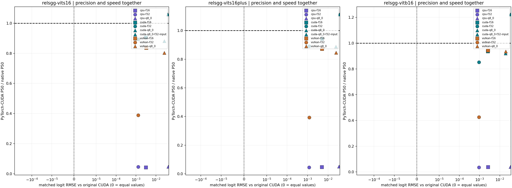

[PNG](gallery/precision_speed_tradeoff.png) · [SVG](gallery/precision_speed_tradeoff.svg)

## 逐 stage 对 CPU 参考误差

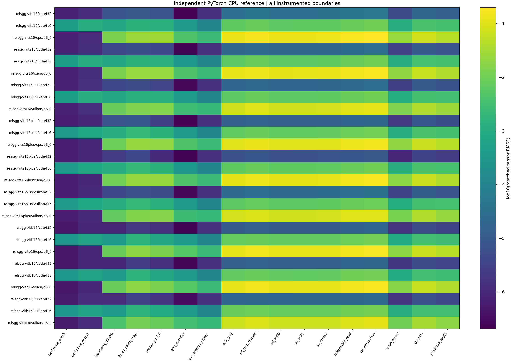

[PNG](gallery/stage_errors_cpu.png) · [SVG](gallery/stage_errors_cpu.svg)

## 逐 stage 对原版 CUDA 参考误差

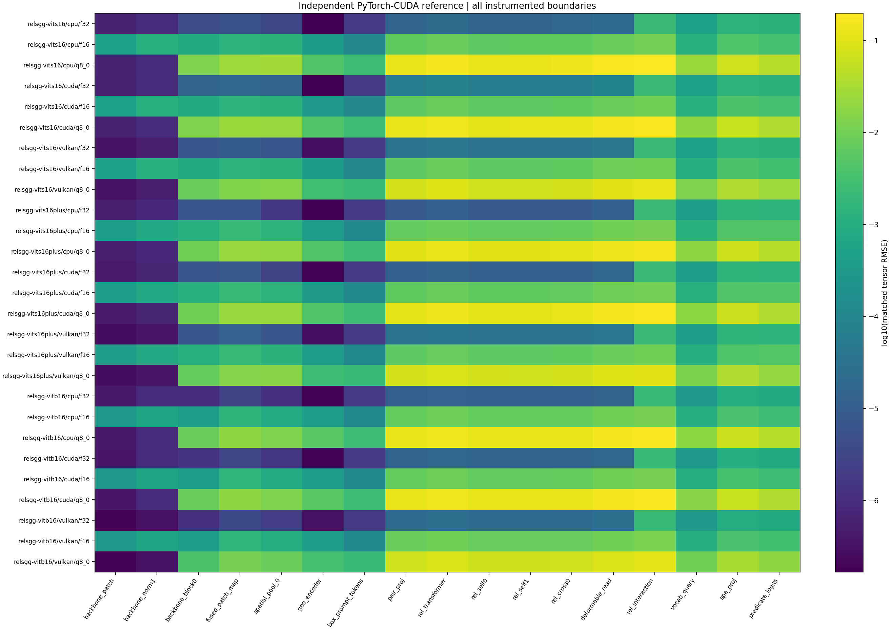

[PNG](gallery/stage_errors_cuda.png) · [SVG](gallery/stage_errors_cuda.svg)

## reference_and_storage_precision

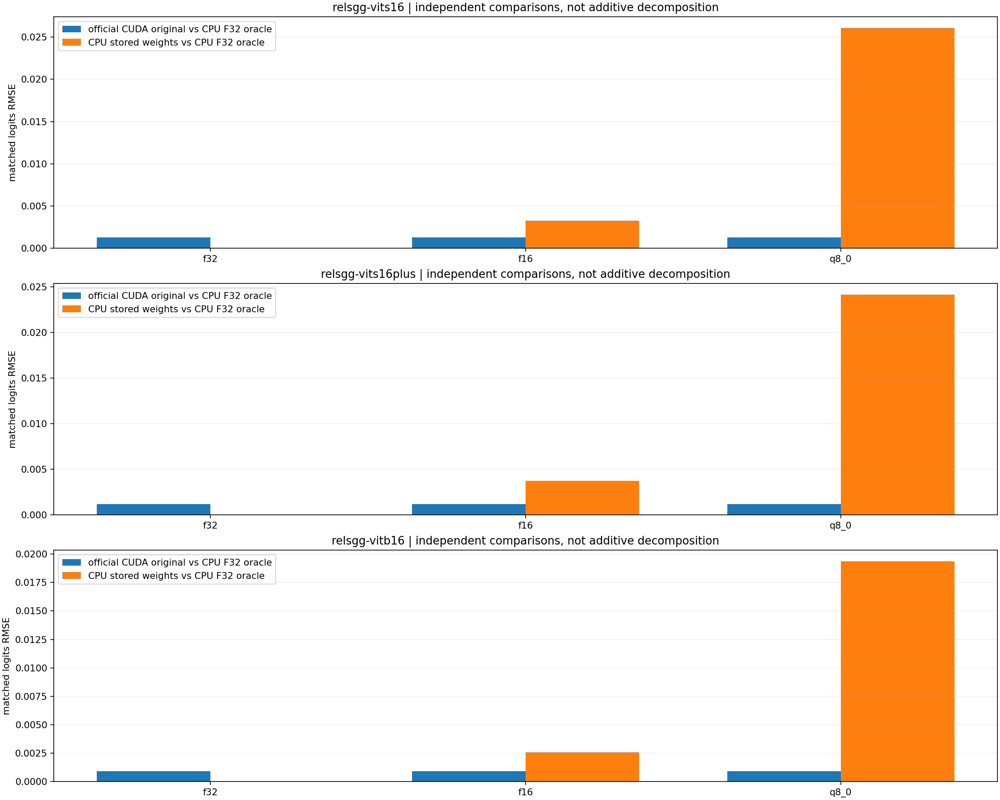

[PNG](gallery/reference_and_storage_precision.png) · [SVG](gallery/reference_and_storage_precision.svg)

## relsgg-vitb16-cpu-f16-numerics

[PNG](gallery/relsgg-vitb16-cpu-f16-numerics.png) · [SVG](gallery/relsgg-vitb16-cpu-f16-numerics.svg)

## relsgg-vitb16-cpu-f32-numerics

[PNG](gallery/relsgg-vitb16-cpu-f32-numerics.png) · [SVG](gallery/relsgg-vitb16-cpu-f32-numerics.svg)

## relsgg-vitb16-cpu-q8_0-numerics

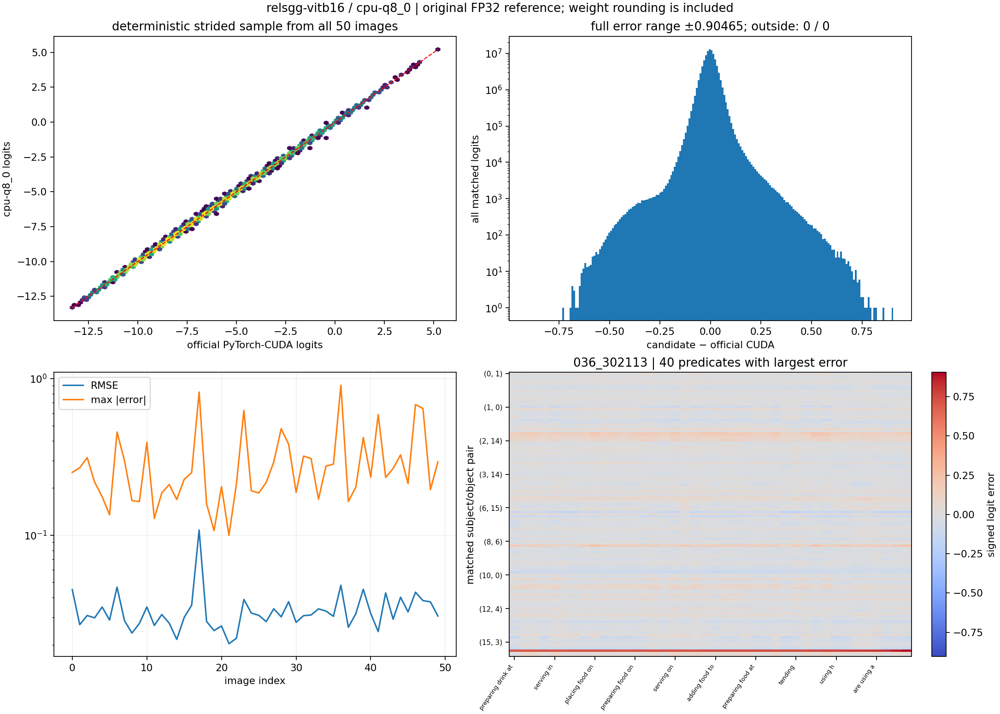

[PNG](gallery/relsgg-vitb16-cpu-q8_0-numerics.png) · [SVG](gallery/relsgg-vitb16-cpu-q8_0-numerics.svg)

## relsgg-vitb16-cuda-f16-numerics

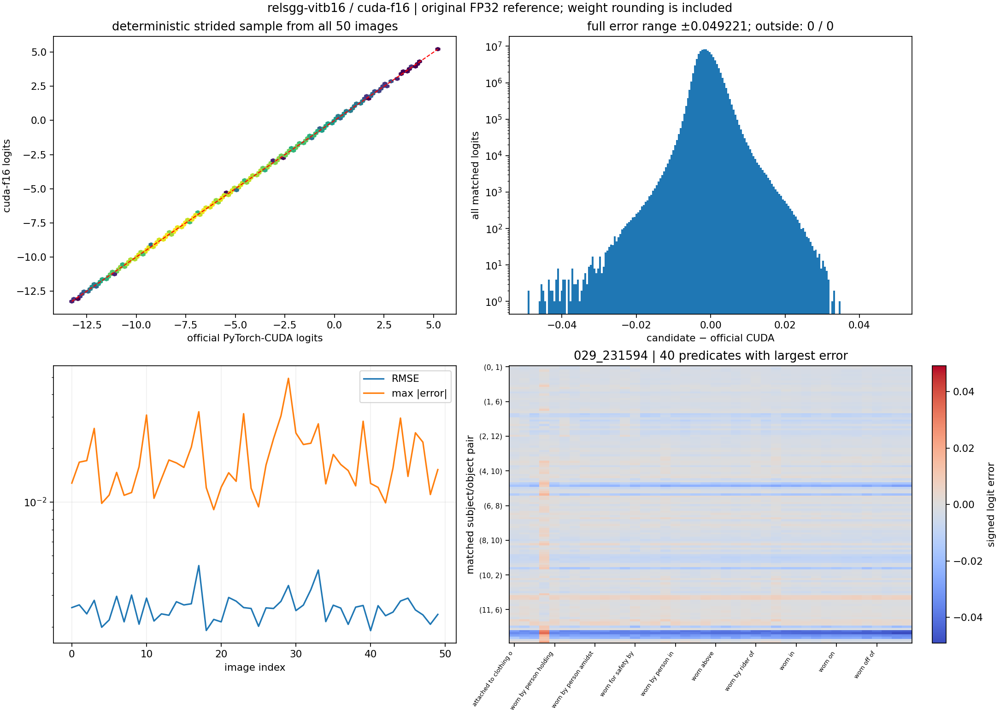

[PNG](gallery/relsgg-vitb16-cuda-f16-numerics.png) · [SVG](gallery/relsgg-vitb16-cuda-f16-numerics.svg)

## relsgg-vitb16-cuda-f32-numerics

[PNG](gallery/relsgg-vitb16-cuda-f32-numerics.png) · [SVG](gallery/relsgg-vitb16-cuda-f32-numerics.svg)

## relsgg-vitb16-cuda-q8_0-f32-input-numerics

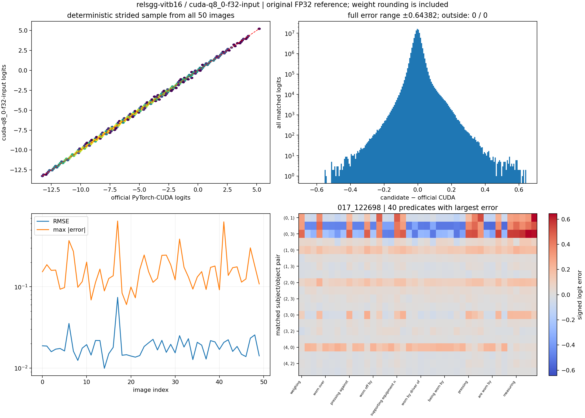

[PNG](gallery/relsgg-vitb16-cuda-q8_0-f32-input-numerics.png) · [SVG](gallery/relsgg-vitb16-cuda-q8_0-f32-input-numerics.svg)

## relsgg-vitb16-cuda-q8_0-numerics

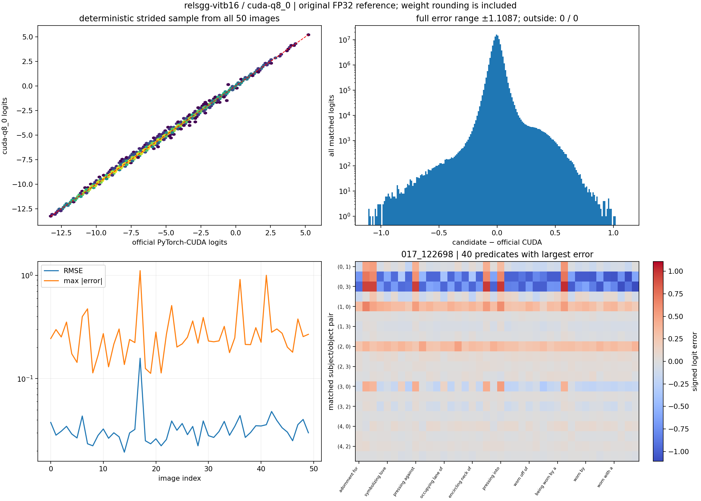

[PNG](gallery/relsgg-vitb16-cuda-q8_0-numerics.png) · [SVG](gallery/relsgg-vitb16-cuda-q8_0-numerics.svg)

## relsgg-vitb16-latency_distribution

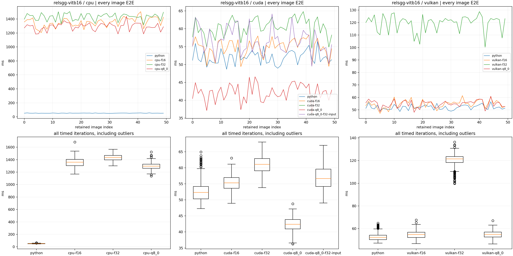

[PNG](gallery/relsgg-vitb16-latency_distribution.png) · [SVG](gallery/relsgg-vitb16-latency_distribution.svg)

## relsgg-vitb16-vulkan-f16-numerics

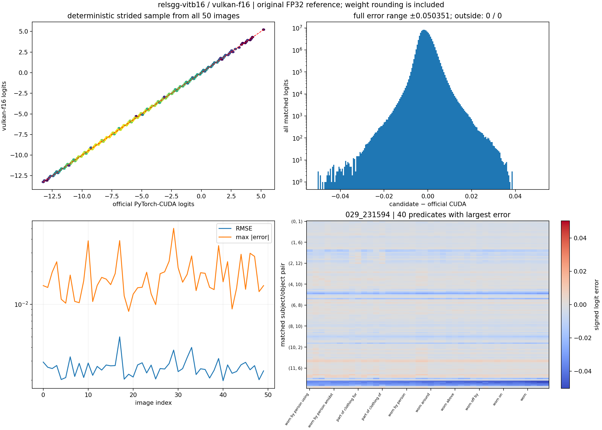

[PNG](gallery/relsgg-vitb16-vulkan-f16-numerics.png) · [SVG](gallery/relsgg-vitb16-vulkan-f16-numerics.svg)

## relsgg-vitb16-vulkan-f32-numerics

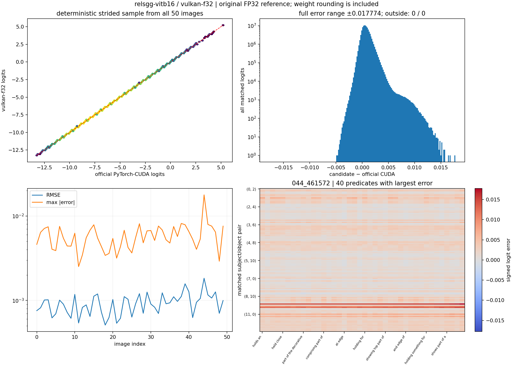

[PNG](gallery/relsgg-vitb16-vulkan-f32-numerics.png) · [SVG](gallery/relsgg-vitb16-vulkan-f32-numerics.svg)

## relsgg-vitb16-vulkan-q8_0-numerics

[PNG](gallery/relsgg-vitb16-vulkan-q8_0-numerics.png) · [SVG](gallery/relsgg-vitb16-vulkan-q8_0-numerics.svg)

## relsgg-vits16-cpu-f16-numerics

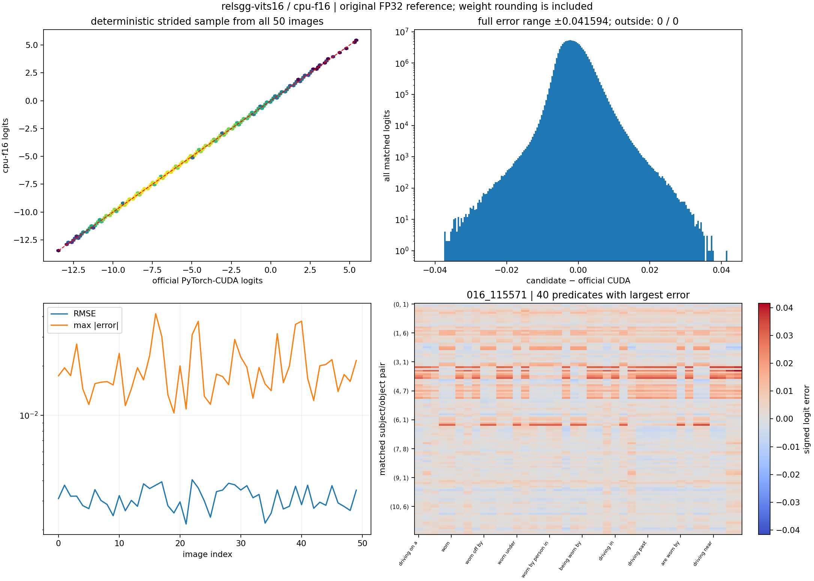

[PNG](gallery/relsgg-vits16-cpu-f16-numerics.png) · [SVG](gallery/relsgg-vits16-cpu-f16-numerics.svg)

## relsgg-vits16-cpu-f32-numerics

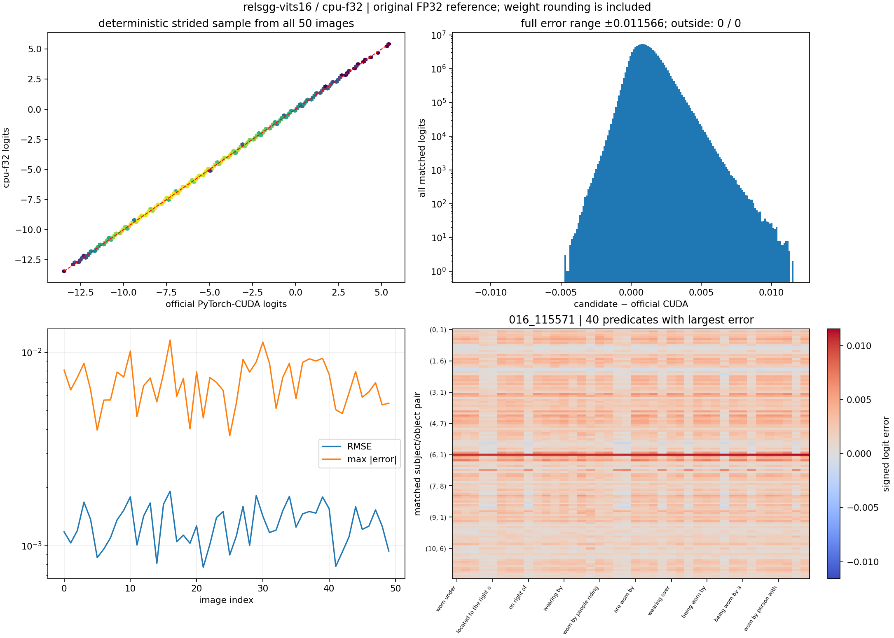

[PNG](gallery/relsgg-vits16-cpu-f32-numerics.png) · [SVG](gallery/relsgg-vits16-cpu-f32-numerics.svg)

## relsgg-vits16-cpu-q8_0-numerics

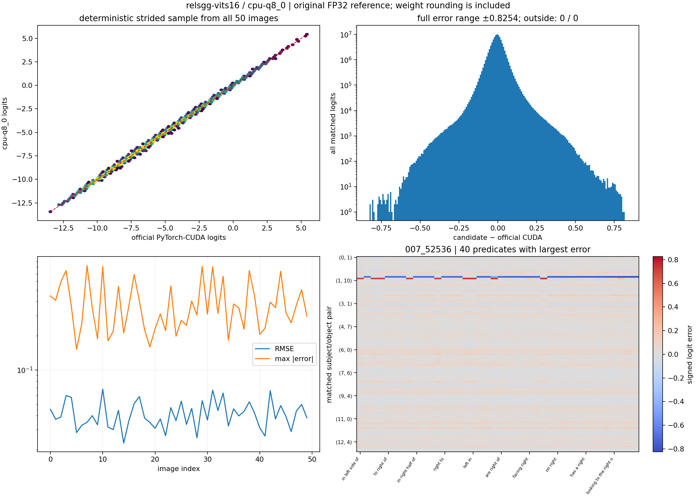

[PNG](gallery/relsgg-vits16-cpu-q8_0-numerics.png) · [SVG](gallery/relsgg-vits16-cpu-q8_0-numerics.svg)

## relsgg-vits16-cuda-f16-numerics

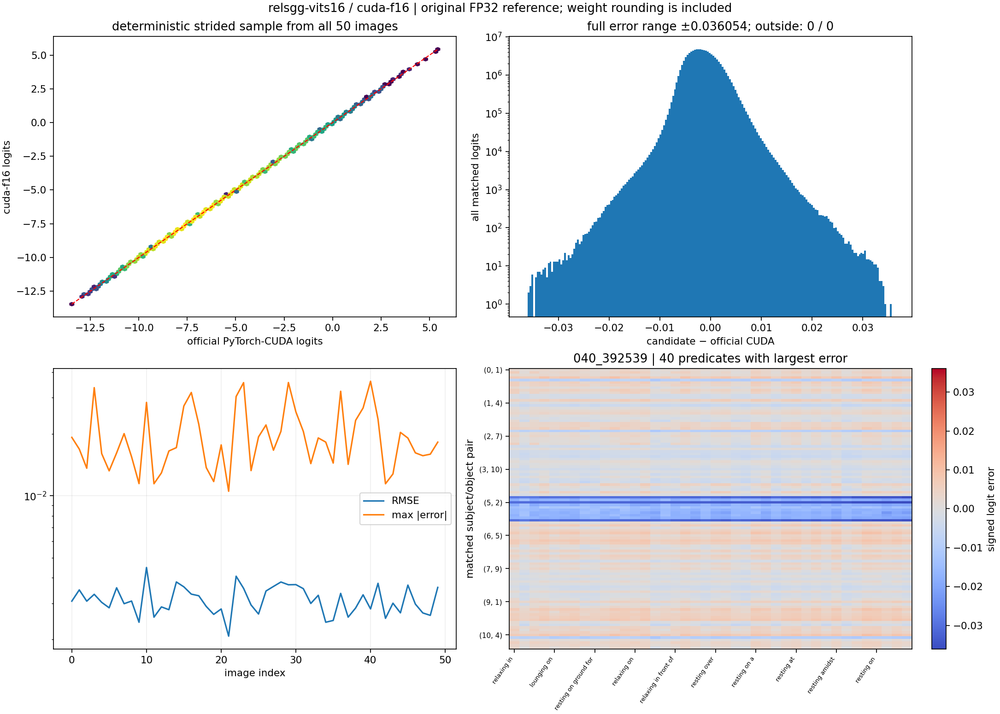

[PNG](gallery/relsgg-vits16-cuda-f16-numerics.png) · [SVG](gallery/relsgg-vits16-cuda-f16-numerics.svg)

## relsgg-vits16-cuda-f32-numerics

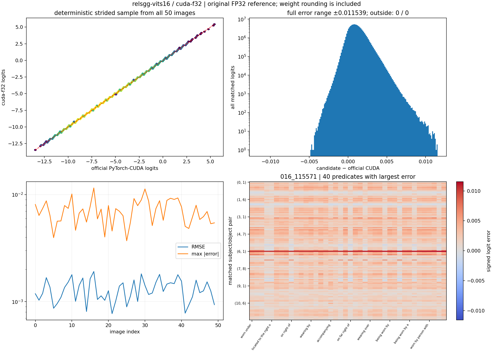

[PNG](gallery/relsgg-vits16-cuda-f32-numerics.png) · [SVG](gallery/relsgg-vits16-cuda-f32-numerics.svg)

## relsgg-vits16-cuda-q8_0-f32-input-numerics

[PNG](gallery/relsgg-vits16-cuda-q8_0-f32-input-numerics.png) · [SVG](gallery/relsgg-vits16-cuda-q8_0-f32-input-numerics.svg)

## relsgg-vits16-cuda-q8_0-numerics

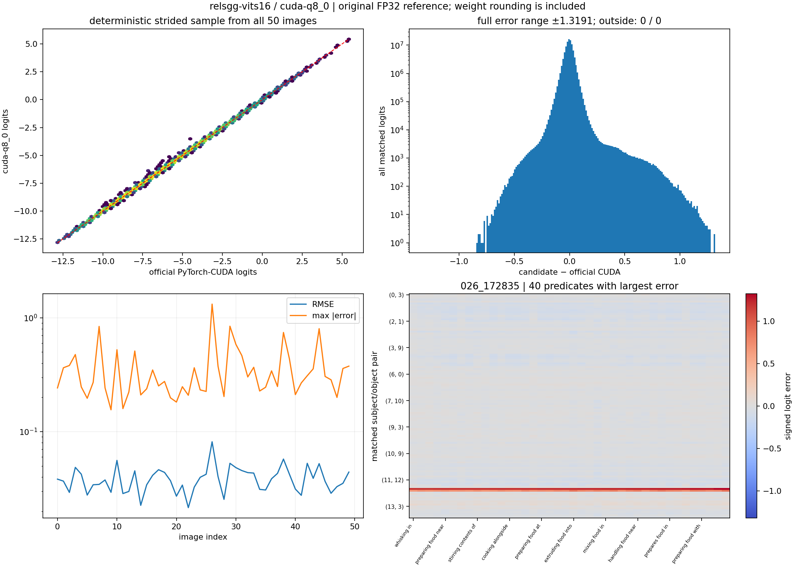

[PNG](gallery/relsgg-vits16-cuda-q8_0-numerics.png) · [SVG](gallery/relsgg-vits16-cuda-q8_0-numerics.svg)

## relsgg-vits16-latency_distribution

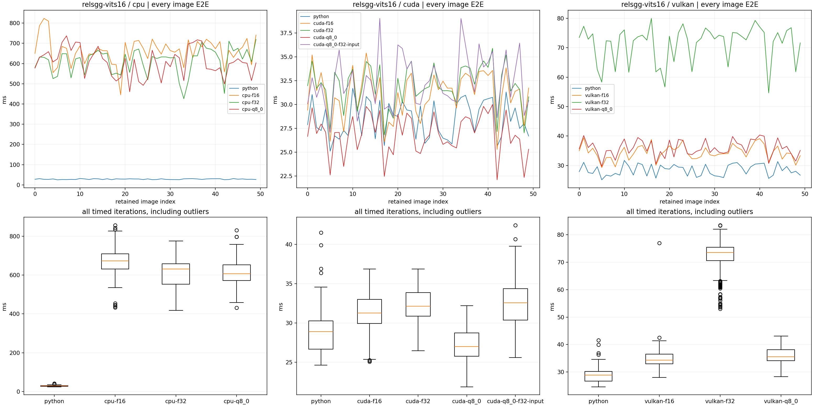

[PNG](gallery/relsgg-vits16-latency_distribution.png) · [SVG](gallery/relsgg-vits16-latency_distribution.svg)

## relsgg-vits16-vulkan-f16-numerics

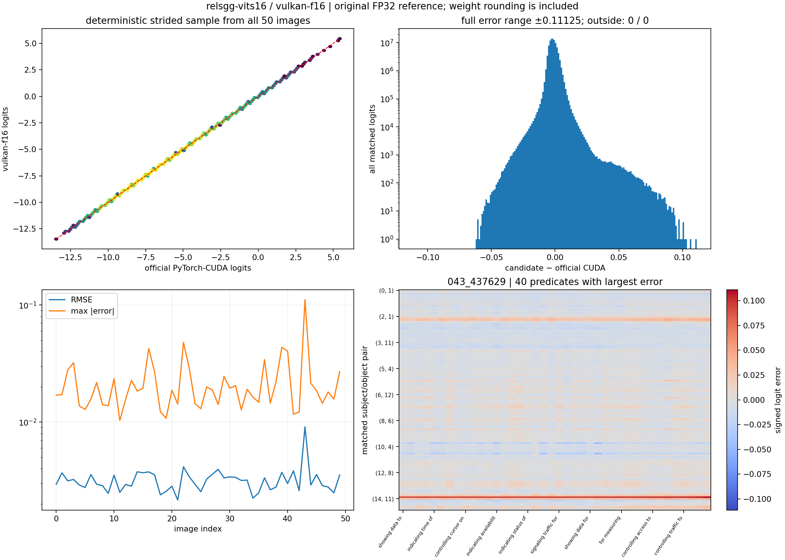

[PNG](gallery/relsgg-vits16-vulkan-f16-numerics.png) · [SVG](gallery/relsgg-vits16-vulkan-f16-numerics.svg)

## relsgg-vits16-vulkan-f32-numerics

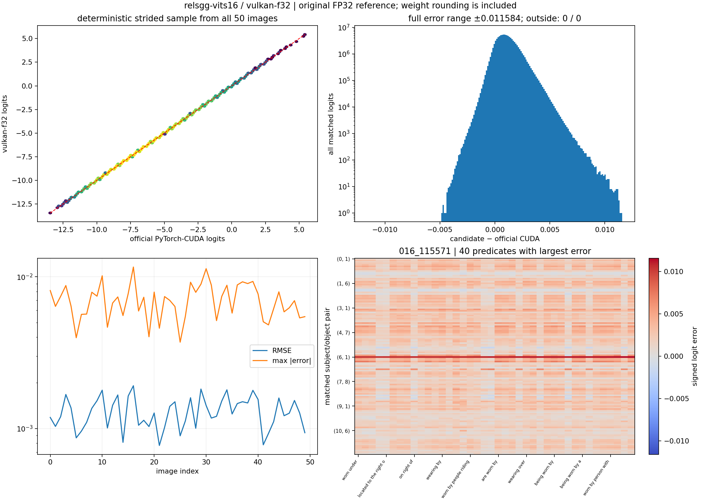

[PNG](gallery/relsgg-vits16-vulkan-f32-numerics.png) · [SVG](gallery/relsgg-vits16-vulkan-f32-numerics.svg)

## relsgg-vits16-vulkan-q8_0-numerics

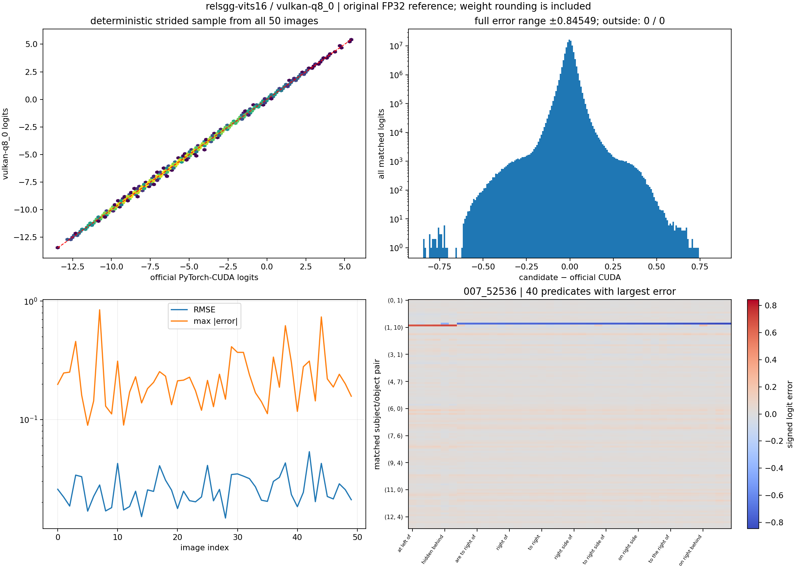

[PNG](gallery/relsgg-vits16-vulkan-q8_0-numerics.png) · [SVG](gallery/relsgg-vits16-vulkan-q8_0-numerics.svg)

## relsgg-vits16plus-cpu-f16-numerics

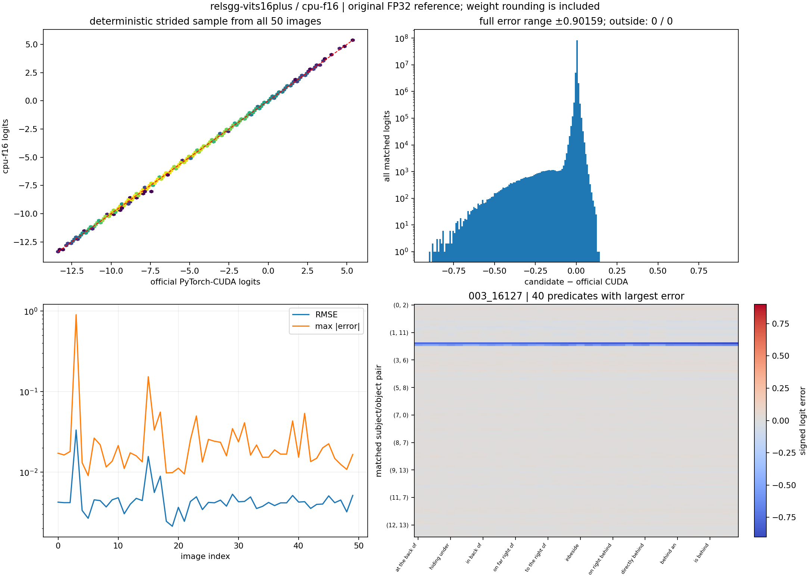

[PNG](gallery/relsgg-vits16plus-cpu-f16-numerics.png) · [SVG](gallery/relsgg-vits16plus-cpu-f16-numerics.svg)

## relsgg-vits16plus-cpu-f32-numerics

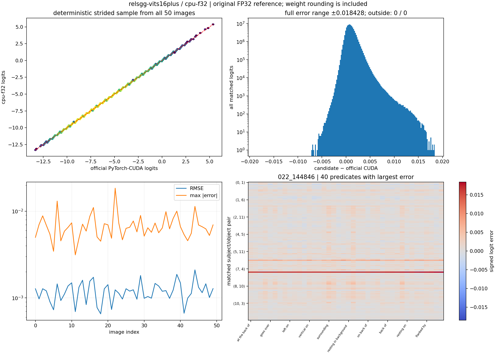

[PNG](gallery/relsgg-vits16plus-cpu-f32-numerics.png) · [SVG](gallery/relsgg-vits16plus-cpu-f32-numerics.svg)

## relsgg-vits16plus-cpu-q8_0-numerics

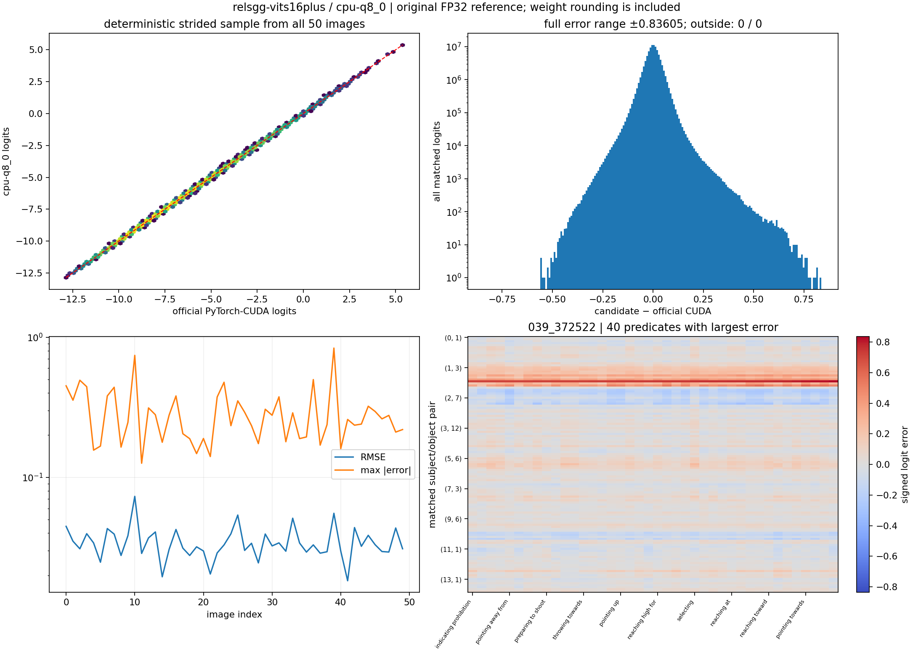

[PNG](gallery/relsgg-vits16plus-cpu-q8_0-numerics.png) · [SVG](gallery/relsgg-vits16plus-cpu-q8_0-numerics.svg)

## relsgg-vits16plus-cuda-f16-numerics

[PNG](gallery/relsgg-vits16plus-cuda-f16-numerics.png) · [SVG](gallery/relsgg-vits16plus-cuda-f16-numerics.svg)

## relsgg-vits16plus-cuda-f32-numerics

[PNG](gallery/relsgg-vits16plus-cuda-f32-numerics.png) · [SVG](gallery/relsgg-vits16plus-cuda-f32-numerics.svg)

## relsgg-vits16plus-cuda-q8_0-f32-input-numerics

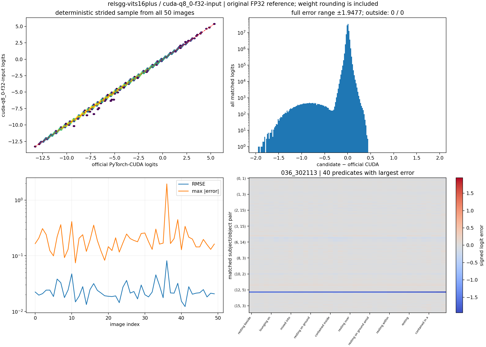

[PNG](gallery/relsgg-vits16plus-cuda-q8_0-f32-input-numerics.png) · [SVG](gallery/relsgg-vits16plus-cuda-q8_0-f32-input-numerics.svg)

## relsgg-vits16plus-cuda-q8_0-numerics

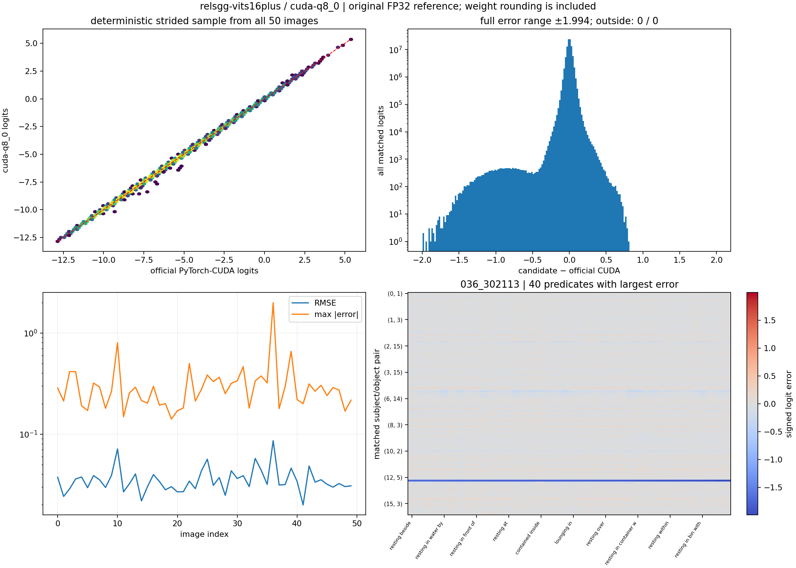

[PNG](gallery/relsgg-vits16plus-cuda-q8_0-numerics.png) · [SVG](gallery/relsgg-vits16plus-cuda-q8_0-numerics.svg)

## relsgg-vits16plus-latency_distribution

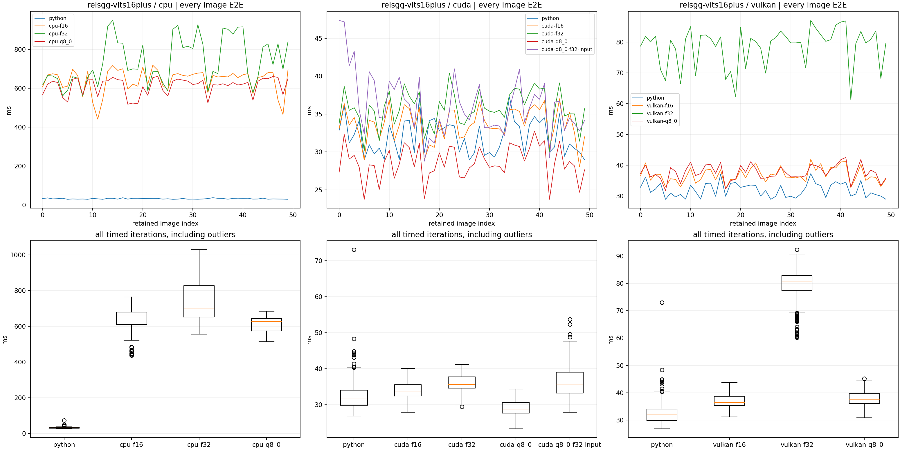

[PNG](gallery/relsgg-vits16plus-latency_distribution.png) · [SVG](gallery/relsgg-vits16plus-latency_distribution.svg)

## relsgg-vits16plus-vulkan-f16-numerics

[PNG](gallery/relsgg-vits16plus-vulkan-f16-numerics.png) · [SVG](gallery/relsgg-vits16plus-vulkan-f16-numerics.svg)

## relsgg-vits16plus-vulkan-f32-numerics

[PNG](gallery/relsgg-vits16plus-vulkan-f32-numerics.png) · [SVG](gallery/relsgg-vits16plus-vulkan-f32-numerics.svg)

## relsgg-vits16plus-vulkan-q8_0-numerics

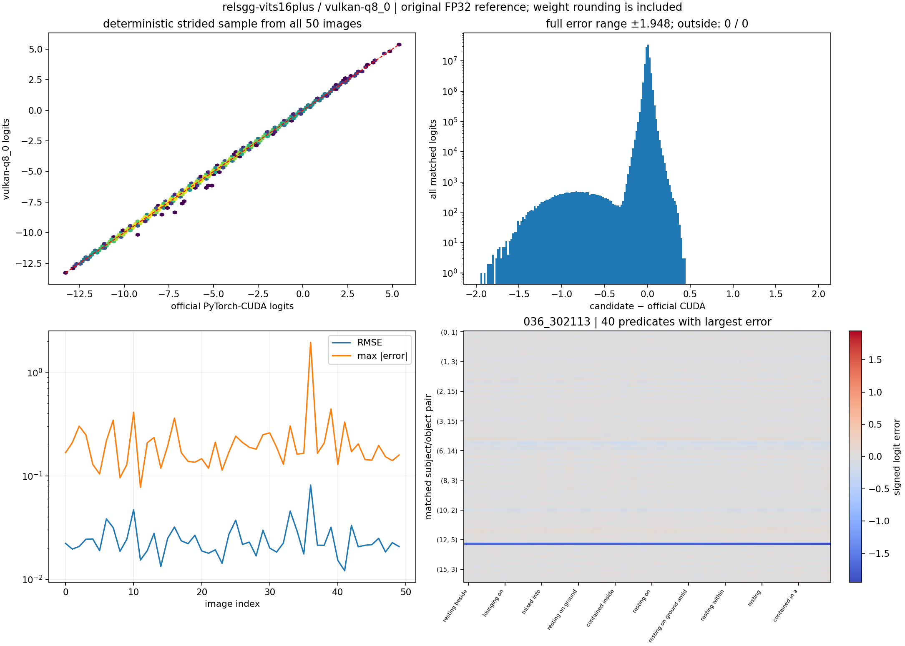

[PNG](gallery/relsgg-vits16plus-vulkan-q8_0-numerics.png) · [SVG](gallery/relsgg-vits16plus-vulkan-q8_0-numerics.svg)

## same_weight_precision

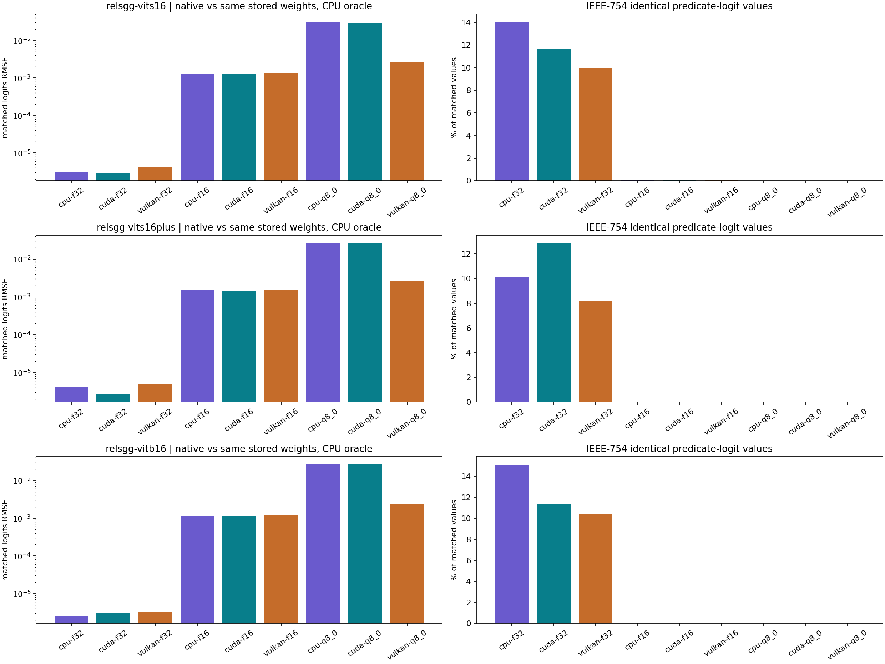

[PNG](gallery/same_weight_precision.png) · [SVG](gallery/same_weight_precision.svg)

## 本轮 strict CUDA 修复与全后端 stage 重测

[新算子、端到端速度和第一处分歧](optimization/index.html)。全模型验收仍为 open。

[SVG](optimization/latency.svg)

[SVG](optimization/precision.svg)

[SVG](optimization/speed_and_replay_bits.svg)

[SVG](optimization/softmax_operator.svg)

[SVG](optimization/stage_errors_cpu.svg)

[SVG](optimization/stage_errors_cuda.svg)

[SVG](optimization/patch_and_next_boundary.svg)

[SVG](optimization/dynamic_vocabulary.svg)

[SVG](optimization/quant_f32_input.svg)

[SVG](optimization/all_backends_latency.svg)

## relsgg-vits16：50 张原图的全部配置网格

- [000_9282](../outputs/runs/20261009-options-alignment/reports/full_graph/visualizations/relsgg-vits16/000_9282.png)
- [001_11355](../outputs/runs/20261009-options-alignment/reports/full_graph/visualizations/relsgg-vits16/001_11355.png)
- [002_14198](../outputs/runs/20261009-options-alignment/reports/full_graph/visualizations/relsgg-vits16/002_14198.png)
- [003_16127](../outputs/runs/20261009-options-alignment/reports/full_graph/visualizations/relsgg-vits16/003_16127.png)
- [004_19163](../outputs/runs/20261009-options-alignment/reports/full_graph/visualizations/relsgg-vits16/004_19163.png)
- [005_24757](../outputs/runs/20261009-options-alignment/reports/full_graph/visualizations/relsgg-vits16/005_24757.png)
- [006_27190](../outputs/runs/20261009-options-alignment/reports/full_graph/visualizations/relsgg-vits16/006_27190.png)
- [007_52536](../outputs/runs/20261009-options-alignment/reports/full_graph/visualizations/relsgg-vits16/007_52536.png)
- [008_55085](../outputs/runs/20261009-options-alignment/reports/full_graph/visualizations/relsgg-vits16/008_55085.png)
- [009_71069](../outputs/runs/20261009-options-alignment/reports/full_graph/visualizations/relsgg-vits16/009_71069.png)
- [010_81185](../outputs/runs/20261009-options-alignment/reports/full_graph/visualizations/relsgg-vits16/010_81185.png)
- [011_91806](../outputs/runs/20261009-options-alignment/reports/full_graph/visualizations/relsgg-vits16/011_91806.png)
- [012_92254](../outputs/runs/20261009-options-alignment/reports/full_graph/visualizations/relsgg-vits16/012_92254.png)
- [013_97855](../outputs/runs/20261009-options-alignment/reports/full_graph/visualizations/relsgg-vits16/013_97855.png)
- [014_102063](../outputs/runs/20261009-options-alignment/reports/full_graph/visualizations/relsgg-vits16/014_102063.png)
- [015_104029](../outputs/runs/20261009-options-alignment/reports/full_graph/visualizations/relsgg-vits16/015_104029.png)
- [016_115571](../outputs/runs/20261009-options-alignment/reports/full_graph/visualizations/relsgg-vits16/016_115571.png)
- [017_122698](../outputs/runs/20261009-options-alignment/reports/full_graph/visualizations/relsgg-vits16/017_122698.png)
- [018_129927](../outputs/runs/20261009-options-alignment/reports/full_graph/visualizations/relsgg-vits16/018_129927.png)
- [019_134453](../outputs/runs/20261009-options-alignment/reports/full_graph/visualizations/relsgg-vits16/019_134453.png)
- [020_143376](../outputs/runs/20261009-options-alignment/reports/full_graph/visualizations/relsgg-vits16/020_143376.png)
- [021_143697](../outputs/runs/20261009-options-alignment/reports/full_graph/visualizations/relsgg-vits16/021_143697.png)
- [022_144846](../outputs/runs/20261009-options-alignment/reports/full_graph/visualizations/relsgg-vits16/022_144846.png)
- [023_147904](../outputs/runs/20261009-options-alignment/reports/full_graph/visualizations/relsgg-vits16/023_147904.png)
- [024_149460](../outputs/runs/20261009-options-alignment/reports/full_graph/visualizations/relsgg-vits16/024_149460.png)
- [025_162793](../outputs/runs/20261009-options-alignment/reports/full_graph/visualizations/relsgg-vits16/025_162793.png)
- [026_172835](../outputs/runs/20261009-options-alignment/reports/full_graph/visualizations/relsgg-vits16/026_172835.png)
- [027_198214](../outputs/runs/20261009-options-alignment/reports/full_graph/visualizations/relsgg-vits16/027_198214.png)
- [028_228279](../outputs/runs/20261009-options-alignment/reports/full_graph/visualizations/relsgg-vits16/028_228279.png)
- [029_231594](../outputs/runs/20261009-options-alignment/reports/full_graph/visualizations/relsgg-vits16/029_231594.png)
- [030_239442](../outputs/runs/20261009-options-alignment/reports/full_graph/visualizations/relsgg-vits16/030_239442.png)
- [031_245050](../outputs/runs/20261009-options-alignment/reports/full_graph/visualizations/relsgg-vits16/031_245050.png)
- [032_265747](../outputs/runs/20261009-options-alignment/reports/full_graph/visualizations/relsgg-vits16/032_265747.png)
- [033_266825](../outputs/runs/20261009-options-alignment/reports/full_graph/visualizations/relsgg-vits16/033_266825.png)
- [034_280716](../outputs/runs/20261009-options-alignment/reports/full_graph/visualizations/relsgg-vits16/034_280716.png)
- [035_300959](../outputs/runs/20261009-options-alignment/reports/full_graph/visualizations/relsgg-vits16/035_300959.png)
- [036_302113](../outputs/runs/20261009-options-alignment/reports/full_graph/visualizations/relsgg-vits16/036_302113.png)
- [037_323754](../outputs/runs/20261009-options-alignment/reports/full_graph/visualizations/relsgg-vits16/037_323754.png)
- [038_358187](../outputs/runs/20261009-options-alignment/reports/full_graph/visualizations/relsgg-vits16/038_358187.png)
- [039_372522](../outputs/runs/20261009-options-alignment/reports/full_graph/visualizations/relsgg-vits16/039_372522.png)
- [040_392539](../outputs/runs/20261009-options-alignment/reports/full_graph/visualizations/relsgg-vits16/040_392539.png)
- [041_431358](../outputs/runs/20261009-options-alignment/reports/full_graph/visualizations/relsgg-vits16/041_431358.png)
- [042_433188](../outputs/runs/20261009-options-alignment/reports/full_graph/visualizations/relsgg-vits16/042_433188.png)
- [043_437629](../outputs/runs/20261009-options-alignment/reports/full_graph/visualizations/relsgg-vits16/043_437629.png)
- [044_461572](../outputs/runs/20261009-options-alignment/reports/full_graph/visualizations/relsgg-vits16/044_461572.png)
- [045_465589](../outputs/runs/20261009-options-alignment/reports/full_graph/visualizations/relsgg-vits16/045_465589.png)
- [046_471413](../outputs/runs/20261009-options-alignment/reports/full_graph/visualizations/relsgg-vits16/046_471413.png)
- [047_475063](../outputs/runs/20261009-options-alignment/reports/full_graph/visualizations/relsgg-vits16/047_475063.png)
- [048_481986](../outputs/runs/20261009-options-alignment/reports/full_graph/visualizations/relsgg-vits16/048_481986.png)
- [049_495397](../outputs/runs/20261009-options-alignment/reports/full_graph/visualizations/relsgg-vits16/049_495397.png)

## relsgg-vits16plus：50 张原图的全部配置网格

- [000_9282](../outputs/runs/20261009-options-alignment/reports/full_graph/visualizations/relsgg-vits16plus/000_9282.png)
- [001_11355](../outputs/runs/20261009-options-alignment/reports/full_graph/visualizations/relsgg-vits16plus/001_11355.png)
- [002_14198](../outputs/runs/20261009-options-alignment/reports/full_graph/visualizations/relsgg-vits16plus/002_14198.png)
- [003_16127](../outputs/runs/20261009-options-alignment/reports/full_graph/visualizations/relsgg-vits16plus/003_16127.png)
- [004_19163](../outputs/runs/20261009-options-alignment/reports/full_graph/visualizations/relsgg-vits16plus/004_19163.png)
- [005_24757](../outputs/runs/20261009-options-alignment/reports/full_graph/visualizations/relsgg-vits16plus/005_24757.png)
- [006_27190](../outputs/runs/20261009-options-alignment/reports/full_graph/visualizations/relsgg-vits16plus/006_27190.png)
- [007_52536](../outputs/runs/20261009-options-alignment/reports/full_graph/visualizations/relsgg-vits16plus/007_52536.png)
- [008_55085](../outputs/runs/20261009-options-alignment/reports/full_graph/visualizations/relsgg-vits16plus/008_55085.png)
- [009_71069](../outputs/runs/20261009-options-alignment/reports/full_graph/visualizations/relsgg-vits16plus/009_71069.png)
- [010_81185](../outputs/runs/20261009-options-alignment/reports/full_graph/visualizations/relsgg-vits16plus/010_81185.png)
- [011_91806](../outputs/runs/20261009-options-alignment/reports/full_graph/visualizations/relsgg-vits16plus/011_91806.png)
- [012_92254](../outputs/runs/20261009-options-alignment/reports/full_graph/visualizations/relsgg-vits16plus/012_92254.png)
- [013_97855](../outputs/runs/20261009-options-alignment/reports/full_graph/visualizations/relsgg-vits16plus/013_97855.png)
- [014_102063](../outputs/runs/20261009-options-alignment/reports/full_graph/visualizations/relsgg-vits16plus/014_102063.png)
- [015_104029](../outputs/runs/20261009-options-alignment/reports/full_graph/visualizations/relsgg-vits16plus/015_104029.png)
- [016_115571](../outputs/runs/20261009-options-alignment/reports/full_graph/visualizations/relsgg-vits16plus/016_115571.png)
- [017_122698](../outputs/runs/20261009-options-alignment/reports/full_graph/visualizations/relsgg-vits16plus/017_122698.png)
- [018_129927](../outputs/runs/20261009-options-alignment/reports/full_graph/visualizations/relsgg-vits16plus/018_129927.png)
- [019_134453](../outputs/runs/20261009-options-alignment/reports/full_graph/visualizations/relsgg-vits16plus/019_134453.png)
- [020_143376](../outputs/runs/20261009-options-alignment/reports/full_graph/visualizations/relsgg-vits16plus/020_143376.png)
- [021_143697](../outputs/runs/20261009-options-alignment/reports/full_graph/visualizations/relsgg-vits16plus/021_143697.png)
- [022_144846](../outputs/runs/20261009-options-alignment/reports/full_graph/visualizations/relsgg-vits16plus/022_144846.png)
- [023_147904](../outputs/runs/20261009-options-alignment/reports/full_graph/visualizations/relsgg-vits16plus/023_147904.png)
- [024_149460](../outputs/runs/20261009-options-alignment/reports/full_graph/visualizations/relsgg-vits16plus/024_149460.png)
- [025_162793](../outputs/runs/20261009-options-alignment/reports/full_graph/visualizations/relsgg-vits16plus/025_162793.png)
- [026_172835](../outputs/runs/20261009-options-alignment/reports/full_graph/visualizations/relsgg-vits16plus/026_172835.png)
- [027_198214](../outputs/runs/20261009-options-alignment/reports/full_graph/visualizations/relsgg-vits16plus/027_198214.png)
- [028_228279](../outputs/runs/20261009-options-alignment/reports/full_graph/visualizations/relsgg-vits16plus/028_228279.png)
- [029_231594](../outputs/runs/20261009-options-alignment/reports/full_graph/visualizations/relsgg-vits16plus/029_231594.png)
- [030_239442](../outputs/runs/20261009-options-alignment/reports/full_graph/visualizations/relsgg-vits16plus/030_239442.png)
- [031_245050](../outputs/runs/20261009-options-alignment/reports/full_graph/visualizations/relsgg-vits16plus/031_245050.png)
- [032_265747](../outputs/runs/20261009-options-alignment/reports/full_graph/visualizations/relsgg-vits16plus/032_265747.png)
- [033_266825](../outputs/runs/20261009-options-alignment/reports/full_graph/visualizations/relsgg-vits16plus/033_266825.png)
- [034_280716](../outputs/runs/20261009-options-alignment/reports/full_graph/visualizations/relsgg-vits16plus/034_280716.png)
- [035_300959](../outputs/runs/20261009-options-alignment/reports/full_graph/visualizations/relsgg-vits16plus/035_300959.png)
- [036_302113](../outputs/runs/20261009-options-alignment/reports/full_graph/visualizations/relsgg-vits16plus/036_302113.png)
- [037_323754](../outputs/runs/20261009-options-alignment/reports/full_graph/visualizations/relsgg-vits16plus/037_323754.png)
- [038_358187](../outputs/runs/20261009-options-alignment/reports/full_graph/visualizations/relsgg-vits16plus/038_358187.png)
- [039_372522](../outputs/runs/20261009-options-alignment/reports/full_graph/visualizations/relsgg-vits16plus/039_372522.png)
- [040_392539](../outputs/runs/20261009-options-alignment/reports/full_graph/visualizations/relsgg-vits16plus/040_392539.png)
- [041_431358](../outputs/runs/20261009-options-alignment/reports/full_graph/visualizations/relsgg-vits16plus/041_431358.png)
- [042_433188](../outputs/runs/20261009-options-alignment/reports/full_graph/visualizations/relsgg-vits16plus/042_433188.png)
- [043_437629](../outputs/runs/20261009-options-alignment/reports/full_graph/visualizations/relsgg-vits16plus/043_437629.png)
- [044_461572](../outputs/runs/20261009-options-alignment/reports/full_graph/visualizations/relsgg-vits16plus/044_461572.png)
- [045_465589](../outputs/runs/20261009-options-alignment/reports/full_graph/visualizations/relsgg-vits16plus/045_465589.png)
- [046_471413](../outputs/runs/20261009-options-alignment/reports/full_graph/visualizations/relsgg-vits16plus/046_471413.png)
- [047_475063](../outputs/runs/20261009-options-alignment/reports/full_graph/visualizations/relsgg-vits16plus/047_475063.png)
- [048_481986](../outputs/runs/20261009-options-alignment/reports/full_graph/visualizations/relsgg-vits16plus/048_481986.png)
- [049_495397](../outputs/runs/20261009-options-alignment/reports/full_graph/visualizations/relsgg-vits16plus/049_495397.png)

## relsgg-vitb16：50 张原图的全部配置网格

- [000_9282](../outputs/runs/20261009-options-alignment/reports/full_graph/visualizations/relsgg-vitb16/000_9282.png)
- [001_11355](../outputs/runs/20261009-options-alignment/reports/full_graph/visualizations/relsgg-vitb16/001_11355.png)
- [002_14198](../outputs/runs/20261009-options-alignment/reports/full_graph/visualizations/relsgg-vitb16/002_14198.png)
- [003_16127](../outputs/runs/20261009-options-alignment/reports/full_graph/visualizations/relsgg-vitb16/003_16127.png)
- [004_19163](../outputs/runs/20261009-options-alignment/reports/full_graph/visualizations/relsgg-vitb16/004_19163.png)
- [005_24757](../outputs/runs/20261009-options-alignment/reports/full_graph/visualizations/relsgg-vitb16/005_24757.png)
- [006_27190](../outputs/runs/20261009-options-alignment/reports/full_graph/visualizations/relsgg-vitb16/006_27190.png)
- [007_52536](../outputs/runs/20261009-options-alignment/reports/full_graph/visualizations/relsgg-vitb16/007_52536.png)
- [008_55085](../outputs/runs/20261009-options-alignment/reports/full_graph/visualizations/relsgg-vitb16/008_55085.png)
- [009_71069](../outputs/runs/20261009-options-alignment/reports/full_graph/visualizations/relsgg-vitb16/009_71069.png)
- [010_81185](../outputs/runs/20261009-options-alignment/reports/full_graph/visualizations/relsgg-vitb16/010_81185.png)
- [011_91806](../outputs/runs/20261009-options-alignment/reports/full_graph/visualizations/relsgg-vitb16/011_91806.png)
- [012_92254](../outputs/runs/20261009-options-alignment/reports/full_graph/visualizations/relsgg-vitb16/012_92254.png)
- [013_97855](../outputs/runs/20261009-options-alignment/reports/full_graph/visualizations/relsgg-vitb16/013_97855.png)
- [014_102063](../outputs/runs/20261009-options-alignment/reports/full_graph/visualizations/relsgg-vitb16/014_102063.png)
- [015_104029](../outputs/runs/20261009-options-alignment/reports/full_graph/visualizations/relsgg-vitb16/015_104029.png)
- [016_115571](../outputs/runs/20261009-options-alignment/reports/full_graph/visualizations/relsgg-vitb16/016_115571.png)
- [017_122698](../outputs/runs/20261009-options-alignment/reports/full_graph/visualizations/relsgg-vitb16/017_122698.png)
- [018_129927](../outputs/runs/20261009-options-alignment/reports/full_graph/visualizations/relsgg-vitb16/018_129927.png)
- [019_134453](../outputs/runs/20261009-options-alignment/reports/full_graph/visualizations/relsgg-vitb16/019_134453.png)
- [020_143376](../outputs/runs/20261009-options-alignment/reports/full_graph/visualizations/relsgg-vitb16/020_143376.png)
- [021_143697](../outputs/runs/20261009-options-alignment/reports/full_graph/visualizations/relsgg-vitb16/021_143697.png)
- [022_144846](../outputs/runs/20261009-options-alignment/reports/full_graph/visualizations/relsgg-vitb16/022_144846.png)
- [023_147904](../outputs/runs/20261009-options-alignment/reports/full_graph/visualizations/relsgg-vitb16/023_147904.png)
- [024_149460](../outputs/runs/20261009-options-alignment/reports/full_graph/visualizations/relsgg-vitb16/024_149460.png)
- [025_162793](../outputs/runs/20261009-options-alignment/reports/full_graph/visualizations/relsgg-vitb16/025_162793.png)
- [026_172835](../outputs/runs/20261009-options-alignment/reports/full_graph/visualizations/relsgg-vitb16/026_172835.png)
- [027_198214](../outputs/runs/20261009-options-alignment/reports/full_graph/visualizations/relsgg-vitb16/027_198214.png)
- [028_228279](../outputs/runs/20261009-options-alignment/reports/full_graph/visualizations/relsgg-vitb16/028_228279.png)
- [029_231594](../outputs/runs/20261009-options-alignment/reports/full_graph/visualizations/relsgg-vitb16/029_231594.png)
- [030_239442](../outputs/runs/20261009-options-alignment/reports/full_graph/visualizations/relsgg-vitb16/030_239442.png)
- [031_245050](../outputs/runs/20261009-options-alignment/reports/full_graph/visualizations/relsgg-vitb16/031_245050.png)
- [032_265747](../outputs/runs/20261009-options-alignment/reports/full_graph/visualizations/relsgg-vitb16/032_265747.png)
- [033_266825](../outputs/runs/20261009-options-alignment/reports/full_graph/visualizations/relsgg-vitb16/033_266825.png)
- [034_280716](../outputs/runs/20261009-options-alignment/reports/full_graph/visualizations/relsgg-vitb16/034_280716.png)
- [035_300959](../outputs/runs/20261009-options-alignment/reports/full_graph/visualizations/relsgg-vitb16/035_300959.png)
- [036_302113](../outputs/runs/20261009-options-alignment/reports/full_graph/visualizations/relsgg-vitb16/036_302113.png)
- [037_323754](../outputs/runs/20261009-options-alignment/reports/full_graph/visualizations/relsgg-vitb16/037_323754.png)
- [038_358187](../outputs/runs/20261009-options-alignment/reports/full_graph/visualizations/relsgg-vitb16/038_358187.png)
- [039_372522](../outputs/runs/20261009-options-alignment/reports/full_graph/visualizations/relsgg-vitb16/039_372522.png)
- [040_392539](../outputs/runs/20261009-options-alignment/reports/full_graph/visualizations/relsgg-vitb16/040_392539.png)
- [041_431358](../outputs/runs/20261009-options-alignment/reports/full_graph/visualizations/relsgg-vitb16/041_431358.png)
- [042_433188](../outputs/runs/20261009-options-alignment/reports/full_graph/visualizations/relsgg-vitb16/042_433188.png)
- [043_437629](../outputs/runs/20261009-options-alignment/reports/full_graph/visualizations/relsgg-vitb16/043_437629.png)
- [044_461572](../outputs/runs/20261009-options-alignment/reports/full_graph/visualizations/relsgg-vitb16/044_461572.png)
- [045_465589](../outputs/runs/20261009-options-alignment/reports/full_graph/visualizations/relsgg-vitb16/045_465589.png)
- [046_471413](../outputs/runs/20261009-options-alignment/reports/full_graph/visualizations/relsgg-vitb16/046_471413.png)
- [047_475063](../outputs/runs/20261009-options-alignment/reports/full_graph/visualizations/relsgg-vitb16/047_475063.png)
- [048_481986](../outputs/runs/20261009-options-alignment/reports/full_graph/visualizations/relsgg-vitb16/048_481986.png)
- [049_495397](../outputs/runs/20261009-options-alignment/reports/full_graph/visualizations/relsgg-vitb16/049_495397.png)

