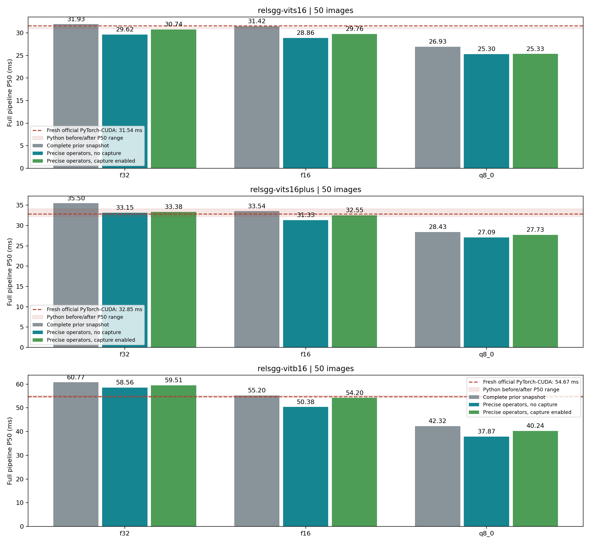
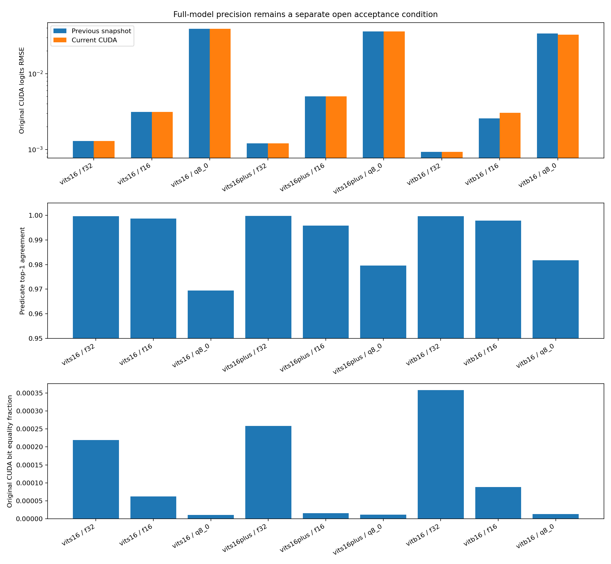
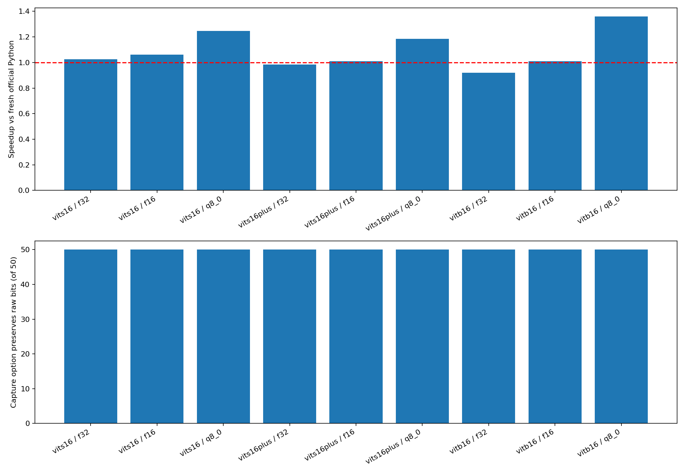
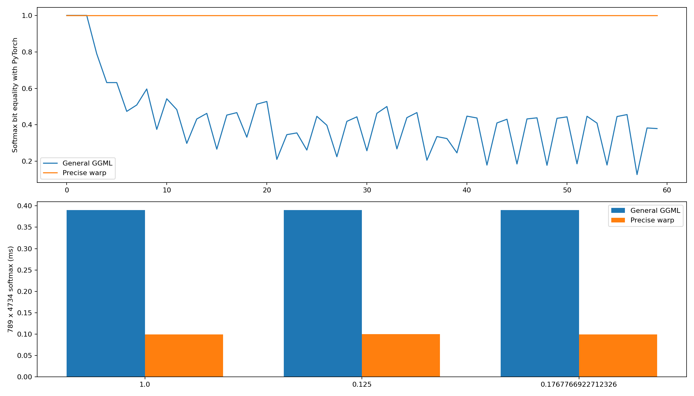
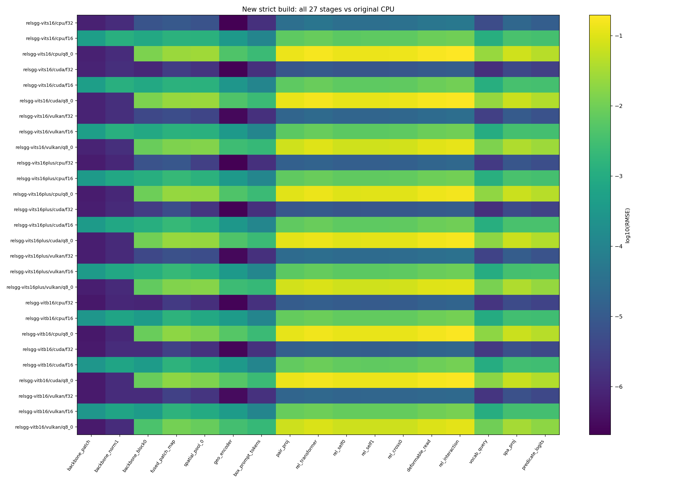
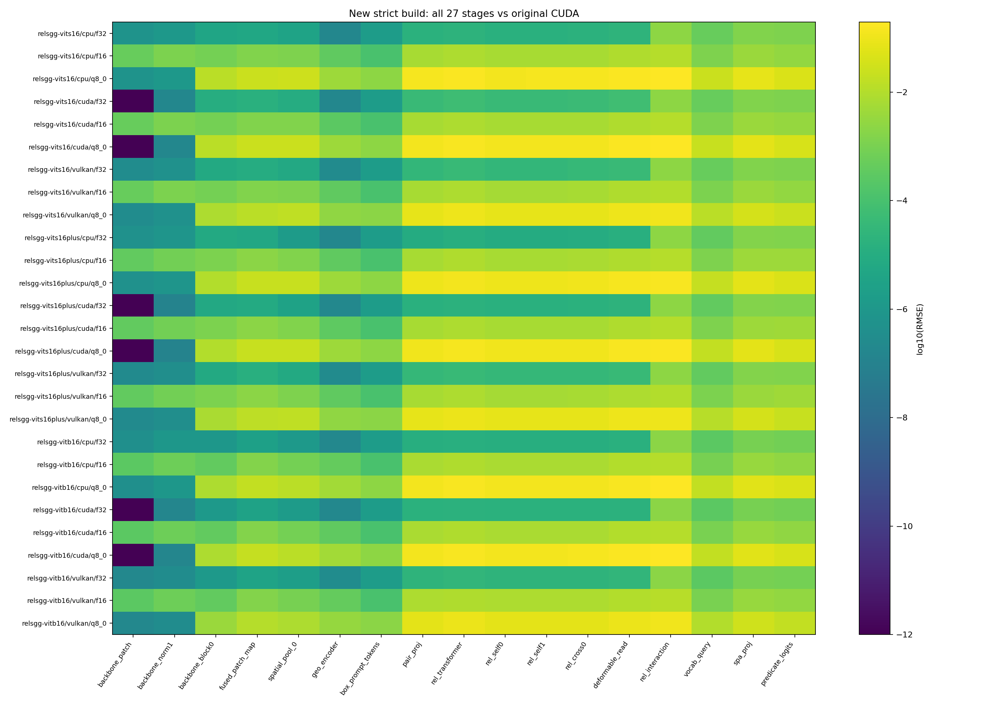
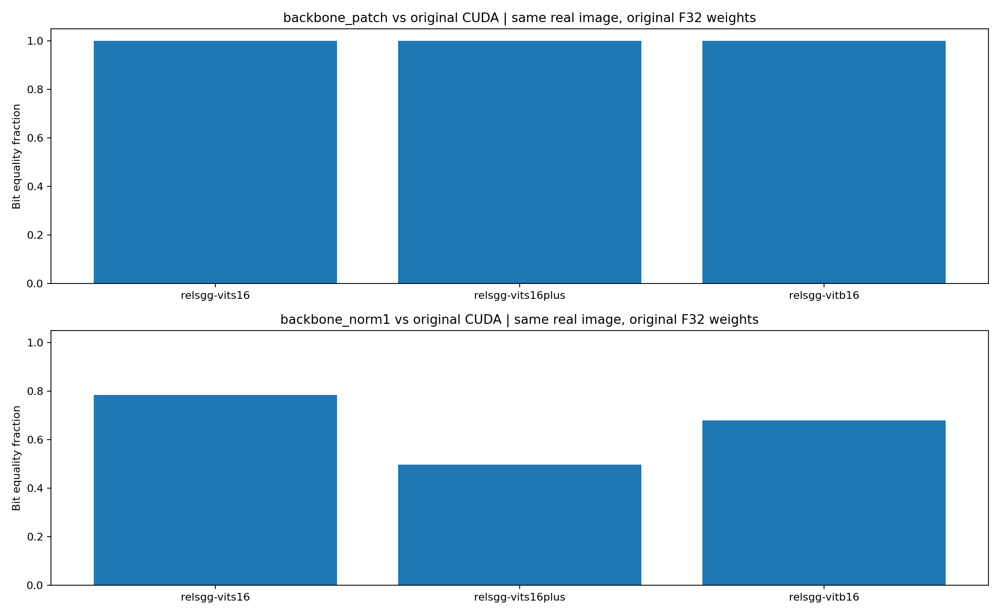
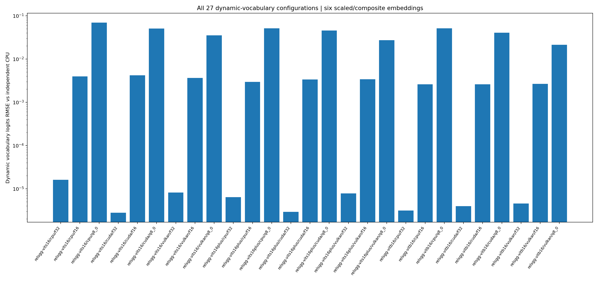
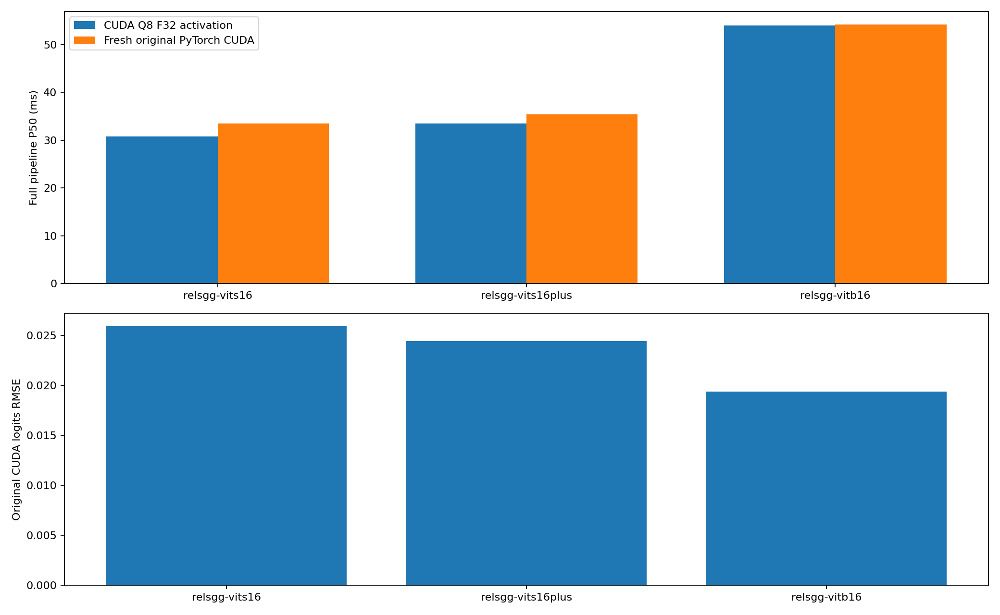
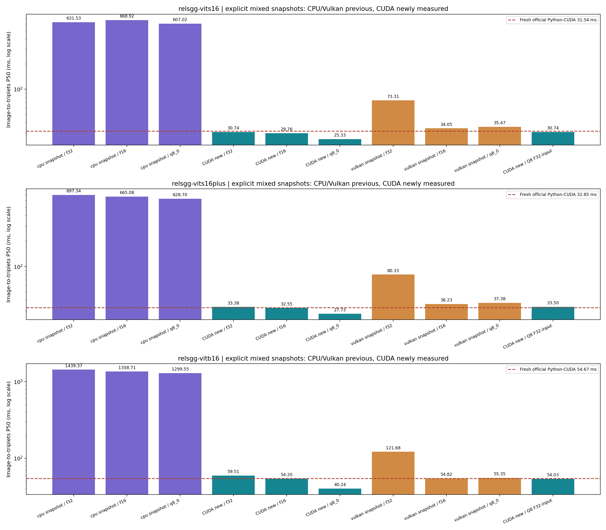

# Strict CUDA 优化进度

这是新 CUDA 的专项重测，覆盖 3 个模型 × F32/F16/Q8 × 50 图，另有 150 图 Q8 F32-input。完整 CPU/CUDA/Vulkan 基线仍在上一级画廊。

**全模型原版 CUDA 逐位一致、全部后端 strict 更快仍为 open。** 算子通过不能替代全模型通过。

计时：原图解码到校准三元组；2 次预热、5 次重复；官方 Python 在每组模型前后独立测量。

| 模型 | 存储 | 原完整基线 ms | 精确算子禁用 capture ms | 启用 capture ms | 本轮 Python ms | 速度倍率 | 预热后 capture 开关逐位相同图数 |
|---|---|---:|---:|---:|---:|---:|---:|
| relsgg-vits16 | f32 | 31.93 | 29.62 | 30.74 | 31.54 | 1.026 | 50/50 |
| relsgg-vits16 | f16 | 31.42 | 28.86 | 29.76 | 31.54 | 1.060 | 50/50 |
| relsgg-vits16 | q8_0 | 26.93 | 25.30 | 25.33 | 31.54 | 1.245 | 50/50 |
| relsgg-vits16plus | f32 | 35.50 | 33.15 | 33.38 | 32.85 | 0.984 | 50/50 |
| relsgg-vits16plus | f16 | 33.54 | 31.33 | 32.55 | 32.85 | 1.009 | 50/50 |
| relsgg-vits16plus | q8_0 | 28.43 | 27.09 | 27.73 | 32.85 | 1.184 | 50/50 |
| relsgg-vitb16 | f32 | 60.77 | 58.56 | 59.51 | 54.67 | 0.919 | 50/50 |
| relsgg-vitb16 | f16 | 55.20 | 50.38 | 54.20 | 54.67 | 1.009 | 50/50 |
| relsgg-vitb16 | q8_0 | 42.32 | 37.87 | 40.24 | 54.67 | 1.359 | 50/50 |

速度倍率使用每图 Python 重复计时汇总后的 50 图 P50；before/after 分布另行保留。7/9 是本轮观测值，接近 1 倍的结果不足以保证稳定更快，且全模型逐位一致仍未通过。

| 模型 | Python 前 P50 ms | Python 后 P50 ms | 漂移 |
|---|---:|---:|---:|
| relsgg-vits16 | 31.13 | 30.98 | 0.48% |
| relsgg-vits16plus | 32.27 | 34.10 | 5.67% |
| relsgg-vitb16 | 55.20 | 54.60 | 1.08% |

60 个受支持 F32 softmax 用例全部逐位一致。超过 1024 列、mask、ALiBi 或 sinks 使用通用回退；其算术未宣称逐位一致。

F32 patch embedding 已改为按 CYX 顺序累积的 F32 FMA。三个真实模型的首个 patch 边界均与原始 CUDA 逐位一致；第一处分歧推进到 LayerNorm。F16/Q8 权重没有原始 F32 信息，未宣称原版权重逐位一致。

已重跑 27 组 stage/dynamic。capture 是否实际发生取决于图的地址和形状是否稳定；启用编译选项不代表每次运行均已 capture。capture 开关位对照使用 3 次预热后导出的所有 tensor、候选索引与 logits；是否发生 capture/launch 另看 profiler 记录。

本轮端到端 profiler：0 次 capture、0 次 graph launch；当前速度变化不能归因于 CUDA Graph 重放。

[完整统计与哈希](summary.json)。F16/Q8 存储误差仍保留；GT 字符串命中不是同义词校准指标。

[SVG](latency.svg)

[SVG](precision.svg)

[SVG](speed_and_replay_bits.svg)

[SVG](softmax_operator.svg)

[SVG](stage_errors_cpu.svg)

[SVG](stage_errors_cuda.svg)

[SVG](patch_and_next_boundary.svg)

[SVG](dynamic_vocabulary.svg)

[SVG](quant_f32_input.svg)

[SVG](all_backends_latency.svg)

