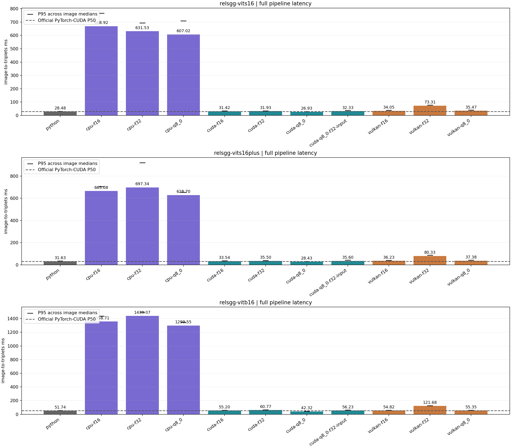
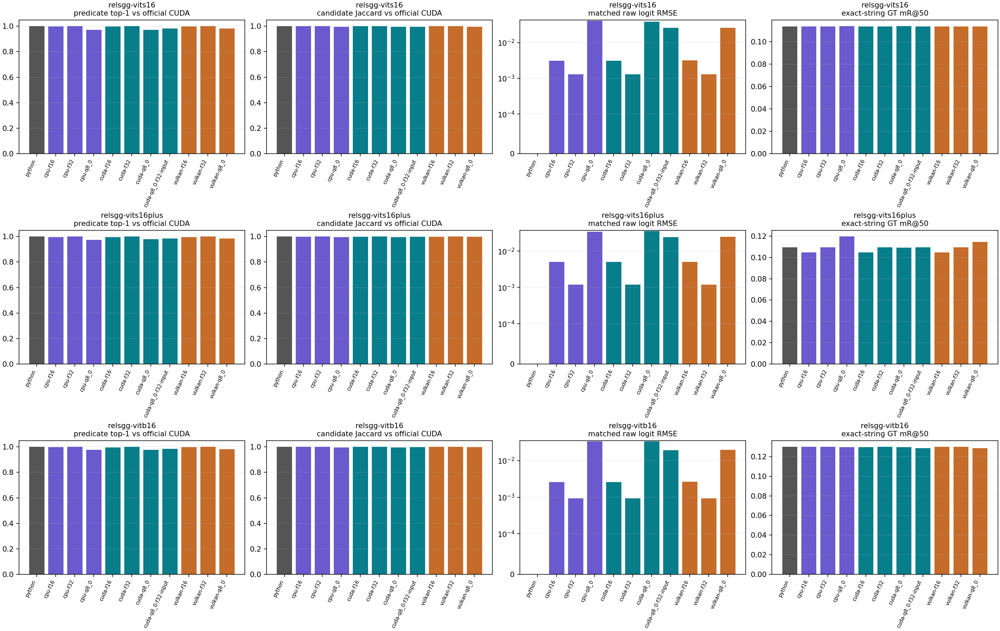

# RelateAnything GGUF model cards

Execution provenance and storage conversion are verified. Numerical and performance gates, effective auto precision modes, and any accepted deviation are recorded in the [release acceptance status](../benchmarks/RELEASE_STATUS.md).

Seven official checkpoint families run through the native C++ image graph. Each has F32, F16 and Q8_0 storage: twenty-one deployment models, no `demo` suffixes. Source weights and sidecars are under `pytorch/`; GGUFs are under `gguf/` and published in [Asher-1/relateanything-ggml-full](https://huggingface.co/Asher-1/relateanything-ggml-full).

## Model families and intended scenarios

| Official checkpoint | Backbone / upstream parameters | Scenario |
|---|---|---|
| [relsgg-vits16](https://huggingface.co/maelic/relsgg-vits16) | DINOv3 ViT-S/16, 46.1M | Lowest-capacity released tower; latency and CPU-sensitive deployment |
| [relsgg-vits16plus](https://huggingface.co/maelic/relsgg-vits16plus) | DINOv3 ViT-S/16+, 53.2M, SwiGLU | Upstream recommended balance of relation quality and cost |
| [relsgg-vitb16](https://huggingface.co/maelic/relsgg-vitb16) | DINOv3 ViT-B/16, 113.8M | Larger visual capacity; use when memory and latency permit |
| [relsgg-convnext-tiny](https://huggingface.co/maelic/relsgg-convnext-tiny) | DINOv3 ConvNeXt-T | Lowest batch-1 GPU latency of the family; best SpatialSense (A6) |
| [relsgg-convnext-small](https://huggingface.co/maelic/relsgg-convnext-small) | DINOv3 ConvNeXt-S | +0.3 OVS over ViT-S/16+ at 1.5× the parameters |
| [relsgg-convnext-base](https://huggingface.co/maelic/relsgg-convnext-base) | DINOv3 ConvNeXt-B | Most accurate tower for its cost (+1.6 OVS over ViT-S/16+) |
| [relsgg-convnext-large](https://huggingface.co/maelic/relsgg-convnext-large) | DINOv3 ConvNeXt-L | ConvNeXt scaling flattens past B (+0.1 OVS at twice the parameters) |

The four ConvNeXt rows quote the upstream release manifest, which measures them with the 2026-10 evaluator; those OVS numbers are not directly comparable with the 2026-08 ViT gate values. The checked-out upstream [release manifest](../../deploy/release_manifest.json) identifies exactly these seven published `final` models. Its three `*-zeroshot` siblings are explicitly `unreleased`, have no `hf_repo`, and have no downloadable weights. They are not omitted supported releases. ONNX/TensorRT exports are deployment formats, not additional checkpoint families; the optional per-model ONNX file is not needed by GGML.

Each local official snapshot contains `model.pth`, `config.json`, `relateanything.json`, `calibration.json`, `thresholds.json`, `predicate_embeddings.npz`, `predicate_bank.npz`, `text_student.pt`, `tokenizer.json` and `tokenizer_config.json`. C++ accepts a replacement embedding bank or encodes free text with the exported text-student GGUF and official tokenizer.

## Nine direct downloads and fingerprints

Every artifact contains DINOv3, prompt/pool/sampler, relation transformer, deformable read, interaction and dynamic vocabulary weights. Export initializes the official full-vocabulary API: the 19,103-row released embedding bank and recomputed alpha replace the checkpoint bank. Predicate names, calibration and source hashes are embedded.

| Model download | Size MiB | Tensors | SHA256 |
|---|---:|---:|---|
| [relsgg-vitb16-f16.gguf](https://huggingface.co/Asher-1/relateanything-ggml-full/resolve/main/gguf/relsgg-vitb16-f16.gguf) | 236.22 | 392 | `fbd6e868e171024182535c281b6ef142b166ea4e67060209d8cfd4b01ac5e911` |
| [relsgg-vitb16-f32.gguf](https://huggingface.co/Asher-1/relateanything-ggml-full/resolve/main/gguf/relsgg-vitb16-f32.gguf) | 471.96 | 392 | `f7d2aa5765877e945d15fc9433c4c947a10e948091692b3f5208c71c24b8e17f` |
| [relsgg-vitb16-q8_0.gguf](https://huggingface.co/Asher-1/relateanything-ggml-full/resolve/main/gguf/relsgg-vitb16-q8_0.gguf) | 136.78 | 392 | `44f40492955b493c53d796c7b4ad65d968dce301cd09567920313bf88e4c2b61` |
| [relsgg-vits16-f16.gguf](https://huggingface.co/Asher-1/relateanything-ggml-full/resolve/main/gguf/relsgg-vits16-f16.gguf) | 107.17 | 392 | `bd5d0eabc41747af6d0243c755f789917c3f53864f763989bee5a4f0371767cf` |
| [relsgg-vits16-f32.gguf](https://huggingface.co/Asher-1/relateanything-ggml-full/resolve/main/gguf/relsgg-vits16-f32.gguf) | 213.86 | 392 | `b87e7cff5e5678e2871cbfcf2804be22e5a9b814a89be763c54c95b9c39468f4` |
| [relsgg-vits16-q8_0.gguf](https://huggingface.co/Asher-1/relateanything-ggml-full/resolve/main/gguf/relsgg-vits16-q8_0.gguf) | 67.19 | 392 | `d281ace4ad9a51edc78da26660ffd89a98d073df352de735711812b48e2dee53` |
| [relsgg-vits16plus-f16.gguf](https://huggingface.co/Asher-1/relateanything-ggml-full/resolve/main/gguf/relsgg-vits16plus-f16.gguf) | 120.71 | 416 | `36ed9f832324dff4d06edf216782eb692645f8f10c0bd7d1b4c5fa58d44d7d39` |
| [relsgg-vits16plus-f32.gguf](https://huggingface.co/Asher-1/relateanything-ggml-full/resolve/main/gguf/relsgg-vits16plus-f32.gguf) | 240.94 | 416 | `24970d851decd61bfdf4b109f5353ff81596ae8d7c9a35635f9de89d17f935e4` |
| [relsgg-vits16plus-q8_0.gguf](https://huggingface.co/Asher-1/relateanything-ggml-full/resolve/main/gguf/relsgg-vits16plus-q8_0.gguf) | 74.43 | 416 | `c19c25acae196e3a762fcbb4032ba450e716847bc66540988d730e4c75572177` |
| [relsgg-convnext-tiny-f32.gguf](https://huggingface.co/Asher-1/relateanything-ggml-full/resolve/main/gguf/relsgg-convnext-tiny-f32.gguf) | 261.48 | 377 | `97fb3e7409699188926cf285d714620cc3dd0f89e13cbe2f3975ff1a78ebb272` |
| [relsgg-convnext-tiny-f16.gguf](https://huggingface.co/Asher-1/relateanything-ggml-full/resolve/main/gguf/relsgg-convnext-tiny-f16.gguf) | 130.98 | 377 | `785d3f0d324bb1412c69df1b89fe04be7cf3afe92258f1e68a78d89ce079a65f` |
| [relsgg-convnext-tiny-q8_0.gguf](https://huggingface.co/Asher-1/relateanything-ggml-full/resolve/main/gguf/relsgg-convnext-tiny-q8_0.gguf) | 91.74 | 377 | `018690fdaf159a9627de71506c93ee85624a77345d1148d3b174ef43a03ec10c` |
| [relsgg-convnext-small-f32.gguf](https://huggingface.co/Asher-1/relateanything-ggml-full/resolve/main/gguf/relsgg-convnext-small-f32.gguf) | 344.03 | 539 | `b5290933a39cff1ef97f064d6965f4d3c5260955a37dbc30728ad21f9344c606` |
| [relsgg-convnext-small-f16.gguf](https://huggingface.co/Asher-1/relateanything-ggml-full/resolve/main/gguf/relsgg-convnext-small-f16.gguf) | 172.26 | 539 | `5cc130db41c1a7de0eb4da5d63539c605686eaadbcd649f92ae2e235f953edf0` |
| [relsgg-convnext-small-q8_0.gguf](https://huggingface.co/Asher-1/relateanything-ggml-full/resolve/main/gguf/relsgg-convnext-small-q8_0.gguf) | 114.80 | 539 | `d0d0431f4e1493c58aa4d428484fbae61b6d0aeb8197879a6f7fc3db17a36e84` |
| [relsgg-convnext-base-f32.gguf](https://huggingface.co/Asher-1/relateanything-ggml-full/resolve/main/gguf/relsgg-convnext-base-f32.gguf) | 508.94 | 539 | `c3ec29b957f6c04d472576dbe052e056925ee56370e852600db7d54bf331a99b` |
| [relsgg-convnext-base-f16.gguf](https://huggingface.co/Asher-1/relateanything-ggml-full/resolve/main/gguf/relsgg-convnext-base-f16.gguf) | 254.72 | 539 | `b7fd03203c87b7203215b4dfe4e58a3d5881368c2015efa6eca23005544d099e` |
| [relsgg-convnext-base-q8_0.gguf](https://huggingface.co/Asher-1/relateanything-ggml-full/resolve/main/gguf/relsgg-convnext-base-q8_0.gguf) | 168.52 | 539 | `549a4ab4a053d582454126d6e3f3dec70969ab1fcdfb91681cab8c01c5cb7dcc` |
| [relsgg-convnext-large-f32.gguf](https://huggingface.co/Asher-1/relateanything-ggml-full/resolve/main/gguf/relsgg-convnext-large-f32.gguf) | 975.26 | 539 | `2fc1d48e2ea8e96ff8429a734205c5915eac73bf774efa2299227b8126d7ecc2` |
| [relsgg-convnext-large-f16.gguf](https://huggingface.co/Asher-1/relateanything-ggml-full/resolve/main/gguf/relsgg-convnext-large-f16.gguf) | 487.88 | 539 | `d0dbd9fea5fd0fe6c728dd6df55b9cb34bb7a5fb9645c5591b7767622b0f3fbc` |
| [relsgg-convnext-large-q8_0.gguf](https://huggingface.co/Asher-1/relateanything-ggml-full/resolve/main/gguf/relsgg-convnext-large-q8_0.gguf) | 320.07 | 539 | `37a743155aab2390f5d7c8c4dd3d3c595d299870ce951db357dd1ade788ea6e2` |

### Native text-student downloads

Free-text encoding uses one additional F32 student for the selected model family, plus its official tokenizer.json. Image weights remain unchanged.

| Text student | Size MiB | Tensors | SHA256 |
|---|---:|---:|---|
| [relsgg-vitb16-text-student-f32.gguf](https://huggingface.co/Asher-1/relateanything-ggml-full/resolve/main/gguf/relsgg-vitb16-text-student-f32.gguf) | 42.86 | 78 | `8cd368fa8692a987a4d8739fcc642dc74fd2902d73ac5544a65f24018656475b` |
| [relsgg-vits16-text-student-f32.gguf](https://huggingface.co/Asher-1/relateanything-ggml-full/resolve/main/gguf/relsgg-vits16-text-student-f32.gguf) | 42.86 | 78 | `8cd368fa8692a987a4d8739fcc642dc74fd2902d73ac5544a65f24018656475b` |
| [relsgg-vits16plus-text-student-f32.gguf](https://huggingface.co/Asher-1/relateanything-ggml-full/resolve/main/gguf/relsgg-vits16plus-text-student-f32.gguf) | 42.86 | 78 | `8cd368fa8692a987a4d8739fcc642dc74fd2902d73ac5544a65f24018656475b` |

[The machine-readable manifest](../benchmarks/full_gguf_manifest.json) records the exact source checkpoint SHA, type counts, missing/extra tensors and numerical verification. All twenty-one files pass the declared storage-conversion check.

### ConvNeXt runtime notes

The ConvNeXt backbone is a hierarchical tower: four stages at strides 4/8/16/32 are brought to the 28×28 patch grid (phase-folding projection for the finer stages, bilinear resize for the stride-32 map) and combined with the same learned softmax over stage weights. Every convolution kernel is dequantized once at model load into a packed F32 buffer, so the stage-fusion projections and depthwise convolutions keep F32 operands on all backends regardless of the stored GGUF type. One image-level raw-logits comparison per model against the official PyTorch CUDA graph on a retained RA-4M frame passes at F32 parity for all four towers: logits RMSE 0.00043–0.00090 (F32, CPU/CUDA/Vulkan), predicate top-1 agreement 1.0, pair-set recall 1.0; F16 0.0033 and Q8_0 0.035 with 0.986 top-1 on `tiny`, in line with the ViT storage baselines. The full 50-image latency and task-metric matrix for the ConvNeXt rows is generated by the next release run and is not yet in the table below.

## Storage policy and selection

| Storage | Conversion | Suitable use |
|---|---|---|
| F32 | Prepared runtime floating tensors stored in F32 | Numerical reference, closest weight representation to official PyTorch |
| F16 | Floating tensors stored in F16; auxiliary values converted as needed by native ops | Smaller files and weight buffers; latency depends on backend kernels |
| Q8_0 | Rank-2 matrices with inner dimension divisible by 32 use Q8_0, except the `vocab_head.W` predicate bank (F16, keeps close top-1 predicates stable under CPU Q8_0 activation rounding); other tensors stay F32 | Lower weight bandwidth/storage, particularly useful on CUDA; inspect ranking drift for your vocabulary |

Default GPU flash attention uses F16 K/V and F32 accumulation. CUDA with F32 weights defaults to `--strict-f32`, which preserves F32 matrix operands and selects explicit attention, so close top-128 candidate pairs do not flip; `--no-strict-f32` restores the faster accelerated path. `--strict-f32` can also be forced for other storage types. `--no-flash-attention` changes attention only. Q8/F16 cannot reproduce original F32 weights bit-for-bit, and close-score predicates/candidates may change. Packed Q/K/V weights consume additional runtime memory.

## Measured full-pipeline evidence

The [portable full report](../benchmarks/summary/README.md) contains three independent official PyTorch-CUDA baselines, 27 primary CPU/CUDA/Vulkan variants, and three additional CUDA Q8 F32-input diagnostics. Each row covers all 50 retained RA-4M images, GT boxes and the full vocabulary. Native timing includes JPEG decode, exact preprocessing, graph construction/allocation/transfers, inference and calibrated ranking. Loading and output files are excluded on both sides. The default `auto` request enables strict arithmetic only for CUDA F32; CPU, Vulkan, F16 and Q8_0 remain non-strict. Each result records both the requested and effective precision mode, so timing is interpreted using the actual path.

[Offline detailed gallery](../benchmarks/gallery/index.html)





Per-image grids cover every retained frame and every engine/storage variant. Numerical metrics include MAE, RMSE, max absolute error, cosine, predicate agreement and pair recall/Jaccard. Task metrics include R/mR@20/50/100, their harmonic F1, weighted recall and explicit local support buckets. Median/P95, throughput and allocator-scoped memory measurements accompany the accuracy rows.

Allocator-scoped GGML buffers and PyTorch peaks remain separately named. Process measurements in the [portable full report](../benchmarks/summary/README.md) additionally sample both engines from startup through load, warmup, inference and output: RSS/HWM plus driver process device memory at 200 ms cadence. These sampled peaks can miss shorter spikes. Shared-machine hardware/process snapshots and every slower native image are retained. Refer to individual speedups instead of assuming every lower-precision format is faster.

The stage report in the [portable full report](../benchmarks/summary/README.md) checks 17 intermediate boundaries in all 27 model/backend/storage configurations, custom vocabulary normalization/gating and 60-region dense candidate selection. 9/9 F32 dense runs retain every candidate and agree on top-1 predicates against the CPU reference. Fixed-candidate traces separate arithmetic error from changed contextual attention. The compact GT set has incomplete positive annotations; it cannot establish negative-set AP, OVS composite or detector accuracy. Public PSG/IndoorVG/VG150 and labelled SpatialSense subsets add independent evaluator regressions. [Metric coverage](../benchmarks/METRIC_COVERAGE.md) explains their limited scope.


### Measured model/backend/storage matrix

RTX 3060; 50 GT-box images, 19,103 predicates; 2 warmups, 5 repeats per image. Speedup is each model’s Python median divided by its GGML median. Accepted timing runs had no unapproved transient GPU process; allowed persistent PIDs and Python bracket drift are recorded per run.

| Model | Engine/storage | Median / P95 ms | Speedup | R@50 | mR@50 | Logit RMSE | Top-1 | GGML buffers MiB |
|---|---|---:|---:|---:|---:|---:|---:|---:|
| relsgg-vits16 | cpu-f16 | 668.92 / 766.16 | 0.04x | 14.45% | 11.37% | 0.00314 | 99.89% | 163.6 |
| relsgg-vits16 | cpu-f32 | 631.53 / 693.03 | 0.05x | 14.45% | 11.37% | 0.00130 | 99.97% | 280.4 |
| relsgg-vits16 | cpu-q8_0 | 607.02 / 708.95 | 0.05x | 14.57% | 11.38% | 0.04172 | 97.09% | 110.1 |
| relsgg-vits16 | cuda-f16 | 31.42 / 34.00 | 0.91x | 14.45% | 11.37% | 0.00313 | 99.86% | 163.6 |
| relsgg-vits16 | cuda-f32 | 31.93 / 34.57 | 0.89x | 14.45% | 11.37% | 0.00130 | 99.97% | 280.4 |
| relsgg-vits16 | cuda-q8_0 | 26.93 / 29.73 | 1.06x | 14.57% | 11.38% | 0.03892 | 97.06% | 110.1 |
| relsgg-vits16 | cuda-q8_0-f32-input | 32.33 / 36.41 | 0.88x | 14.45% | 11.37% | 0.02598 | 98.19% | 110.1 |
| relsgg-vits16 | python | 28.48 / 31.01 | 1.00x | 14.45% | 11.37% | 0.00000 | 100.00% | — |
| relsgg-vits16 | vulkan-f16 | 34.05 / 38.74 | 0.84x | 14.45% | 11.37% | 0.00323 | 99.79% | 161.3 |
| relsgg-vits16 | vulkan-f32 | 73.31 / 77.75 | 0.39x | 14.45% | 11.37% | 0.00130 | 99.97% | 278.6 |
| relsgg-vits16 | vulkan-q8_0 | 35.47 / 39.89 | 0.80x | 14.45% | 11.37% | 0.02633 | 98.19% | 108.3 |
| relsgg-vits16plus | cpu-f16 | 665.08 / 704.25 | 0.05x | 16.94% | 10.47% | 0.00502 | 99.66% | 177.1 |
| relsgg-vits16plus | cpu-f32 | 697.34 / 920.58 | 0.05x | 17.06% | 10.96% | 0.00120 | 99.98% | 307.5 |
| relsgg-vits16plus | cpu-q8_0 | 628.70 / 655.25 | 0.05x | 17.43% | 11.95% | 0.03480 | 97.32% | 117.3 |
| relsgg-vits16plus | cuda-f16 | 33.54 / 36.69 | 0.94x | 16.94% | 10.47% | 0.00504 | 99.66% | 177.1 |
| relsgg-vits16plus | cuda-f32 | 35.50 / 39.05 | 0.89x | 17.06% | 10.96% | 0.00120 | 99.98% | 307.5 |
| relsgg-vits16plus | cuda-q8_0 | 28.43 / 31.44 | 1.11x | 16.81% | 10.90% | 0.03608 | 98.04% | 117.4 |
| relsgg-vits16plus | cuda-q8_0-f32-input | 35.60 / 42.42 | 0.89x | 17.06% | 10.96% | 0.02444 | 98.37% | 117.4 |
| relsgg-vits16plus | python | 31.63 / 35.66 | 1.00x | 17.06% | 10.96% | 0.00000 | 100.00% | — |
| relsgg-vits16plus | vulkan-f16 | 36.23 / 40.94 | 0.87x | 16.94% | 10.47% | 0.00507 | 99.61% | 174.8 |
| relsgg-vits16plus | vulkan-f32 | 80.33 / 86.09 | 0.39x | 17.06% | 10.96% | 0.00120 | 99.98% | 305.7 |
| relsgg-vits16plus | vulkan-q8_0 | 37.38 / 41.50 | 0.85x | 17.19% | 11.45% | 0.02478 | 98.38% | 115.5 |
| relsgg-vitb16 | cpu-f16 | 1358.71 / 1436.32 | 0.04x | 17.56% | 13.00% | 0.00260 | 99.82% | 333.7 |
| relsgg-vitb16 | cpu-f32 | 1439.37 / 1495.20 | 0.04x | 17.56% | 13.00% | 0.00093 | 99.97% | 609.9 |
| relsgg-vitb16 | cpu-q8_0 | 1299.55 / 1347.96 | 0.04x | 17.56% | 12.96% | 0.03351 | 97.80% | 206.5 |
| relsgg-vitb16 | cuda-f16 | 55.20 / 57.81 | 0.94x | 17.43% | 12.98% | 0.00257 | 99.66% | 333.7 |
| relsgg-vitb16 | cuda-f32 | 60.77 / 63.75 | 0.85x | 17.56% | 13.00% | 0.00093 | 99.97% | 609.9 |
| relsgg-vitb16 | cuda-q8_0 | 42.32 / 45.28 | 1.22x | 17.56% | 12.98% | 0.03382 | 97.73% | 206.6 |
| relsgg-vitb16 | cuda-q8_0-f32-input | 56.23 / 63.00 | 0.92x | 17.56% | 12.87% | 0.01926 | 98.62% | 206.6 |
| relsgg-vitb16 | python | 51.74 / 55.31 | 1.00x | 17.56% | 13.00% | 0.00000 | 100.00% | — |
| relsgg-vitb16 | vulkan-f16 | 54.82 / 60.15 | 0.94x | 17.56% | 13.00% | 0.00263 | 99.79% | 329.1 |
| relsgg-vitb16 | vulkan-f32 | 121.68 / 127.14 | 0.43x | 17.56% | 13.00% | 0.00093 | 99.97% | 603.0 |
| relsgg-vitb16 | vulkan-q8_0 | 55.35 / 58.63 | 0.93x | 17.56% | 12.87% | 0.01959 | 98.28% | 199.6 |

Some measured native configurations do not beat Python; consult the individual rows. Shared-workstation results are specific to the recorded process load. F32 does not imply bit-identical GPU kernels; full errors and candidate changes are disclosed.

The [portable full report](../benchmarks/summary/README.md) includes weight-rounding versus same-weight arithmetic for every retained image through the official Python graph with all GGUF weights restored, plus the CUDA Q8 F32-activation precision isolation. Superseded experiments were removed after replacement; the cleanup manifest records their identities.

## Supported interface and limits

- Batch 1, 448×448, boxes, up to `ModelOptions.max_boxes` (default 60), 128 candidate slots; all seven released checkpoints across the ViT and ConvNeXt families.
- CPU, CUDA and Vulkan execute native GGML graphs; no Python inference or cuDNN dependency in C++.
- `ModelOptions` configures model/backend/precision mode/threads/vocabulary, with explicit `RuntimeOptions` for backend policy. `ImageInput` supplies image and pixel XYXY boxes.
- The versioned C ABI accepts borrowed RGB/RGBA/GRAY/BGR/BGRA memory with stride; results have independent ownership. A host can bind its existing backend lease. See [integration contract](../benchmarks/PORTING_NOTES.md).
- Replacement vocabularies use finite row-major F32 `[V,512]` embeddings or native CLIP BPE/text-student encoding. The head normalizes them and computes its learned gate.
- Native masks, detector-score weighting and decomposed spatial/semantic outputs are independently compared with Python on all three models and backends. The 50-image timing profile uses boxes only.
- GT-box evaluation measures relation prediction, not detector localization or end-to-end detection recall.

```sh
./run_ggml.sh --backend cuda --model-name relsgg-vits16plus --dtype q8_0 --download
./run_ggml.sh --backend vulkan --model-name relsgg-vitb16 --dtype f16
./run_ggml.sh --engine python --backend cuda
```

## Fixture isolation

The three `relation_pair_linear_v1-fixture-*` files under `test_data/fixtures/` are small format/loader inputs. They contain no official DINOv3 checkpoint and contribute no numbers to the full-model reports.

## Provenance and terms

This is a downstream GGUF conversion, not an upstream-official GGUF release. The source model cards identify the DINOv3 model license; conversion does not replace those terms. See the [source model card](https://huggingface.co/maelic/relsgg-vits16plus) and [DINOv3 license](https://ai.meta.com/resources/models-and-libraries/dinov3-license/). Source code licensing remains governed by this repository’s LICENSE. Retained dataset images keep their original COCO/Objects365/Open Images terms.
